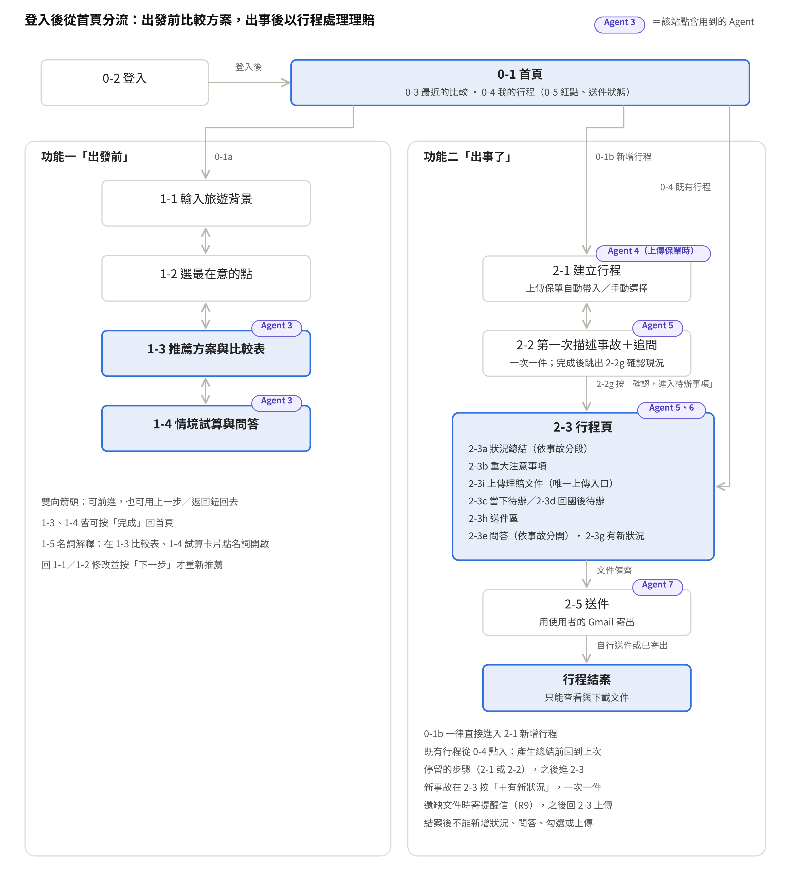
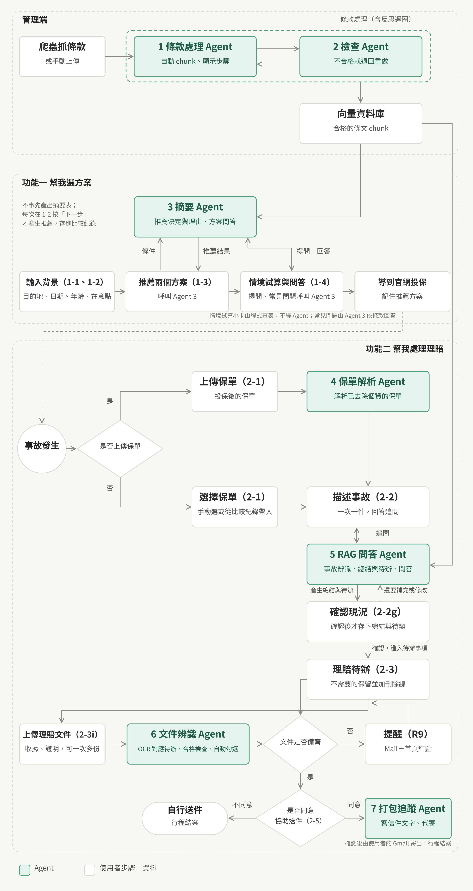

# 好險有你 產品規格書 11/13 v3.10

Nov 13, 2026 · @Leon

## 目錄

- 1\. 產品概述
  - 1.1 範圍
  - 1.2 名詞
- 2\. 整站流程
  - 2.1 功能一主流程
  - 2.2 功能二主流程
- 3\. 全站共通規則
  - 3.1 裝置與版面
  - 3.2 登入
  - 3.3 共用頁首（H）
  - 3.4 自動存檔
  - 3.5 紀錄進度與接續
  - 3.6 修改前面的輸入
  - 3.7 顯示格式
  - 3.8 數字來源
  - 3.9 AI 產生中
- 4\. 推薦、試算與待辦規則
  - 4.1 目的地與醫療費等級（R1）
  - 4.2 推薦保額（R2）
  - 4.3 可投保方案與推薦（R3）
  - 4.4 情境試算（R4）
  - 4.5 待辦產生與更新（R5）
  - 4.6 在意點與情境（R6）
  - 4.7 事故類型與必問欄位（R7）
  - 4.8 文件辨識（R8）
  - 4.9 提醒信（R9）
  - 4.10 送件（R10）
- 5\. 首頁（0-x）
  - 5.1 登入（0-2）
  - 5.2 首頁（0-1）
  - 5.3 最近的比較（0-3）
  - 5.4 我的行程（0-4）
  - 5.5 未完成標示（0-5）
  - 5.6 全部紀錄（0-6）
- 6\. 功能一「出發前：幫我選方案」（1-x）
  - 6.1 輸入旅遊背景（1-1）
  - 6.2 選擇最在意的點（1-2）
  - 6.3 推薦方案與比較表（1-3）
  - 6.4 情境試算與問答（1-4）
  - 6.5 名詞解釋（1-5）
- 7\. 功能二「出事了：幫我處理理賠」（2-x）
  - 7.1 建立行程（2-1）
  - 7.2 描述事故（2-2）
  - 7.3 行程頁（2-3）
    - 7.3.1 狀況總結（2-3a）
    - 7.3.2 重大注意事項（2-3b）
    - 7.3.3 理賠待辦（2-3c、2-3d）
    - 7.3.4 送件區（2-3h）
    - 7.3.5 問答（2-3e）
    - 7.3.6 完成（2-3f）
    - 7.3.7 上傳理賠文件（2-3i）
  - 7.4 送件（2-5）
- 8\. AI 行為規格
  - 8.1 共通規則
  - 8.2 條款處理與檢查（Agent 1、2，管理端）
  - 8.3 摘要（Agent 3，1-3、1-4）
  - 8.4 保單解析（Agent 4，2-1）
  - 8.5 RAG 問答（Agent 5，2-2、2-3、2-3e）
  - 8.6 文件辨識（Agent 6，2-3）
  - 8.7 打包追蹤（Agent 7，2-5）
- 9\. 事先準備的內容
- 10\. 本版不做
- 11\. 待討論事項

章節編號（例：6.3）用於閱讀與討論；括號內的代碼（例：1-3、R3、Agent 3）是畫面、規則與 Agent 的編號，文件內互相引用時使用。

## 1. 產品概述

好險有你是 RWD 響應式網站（手機、平板、桌機皆可使用）：出發前幫旅客從多家保險公司的方案中推薦並比較兩個方案，出事時依保單整理可能適用的理賠項目與待辦。所有紀錄自動存檔，換裝置或隔天回來都能接著用。

| 區塊 | 使用時機 | 使用者得到什麼 |
| --- | --- | --- |
| 首頁（0-x） | 每次進站 | 兩個入口，以及最近的比較與行程 |
| 功能一「出發前：幫我選方案」（1-x） | 投保前 | 推薦與次推薦方案、推薦保額、比較表、情境試算、問答 |
| 功能二「出事了：幫我處理理賠」（2-x） | 出發前取消、旅途中出事、回國後 | 以行程為單位，整理該趟所有事故的可能適用項目、當下與回國後待辦、問答，並可上傳理賠文件、協助用 Gmail 送件 |

### 1.1 範圍

- 支援多家保險公司的旅遊保險方案，本版支援易安網上所有的旅平險，共 5 家保險公司（方案資料從易安網爬取）；推薦可跨公司。
- 方案一律以「公司＋方案名」顯示（例：「○○產險 旅遊綜合保險豪華型」）。
- 單人、國外旅遊；目的地限於 R1 列出的 16 個。
- 功能二每個行程只支援一張保單，可記錄多個事故，所有理賠判斷與待辦都依該保單產生。
- 功能二的送件只支援使用者自己的 Gmail，且須使用者確認後才寄出。
- 本規格只描述主要流程。

### 1.2 名詞

| 名詞 | 意思 |
| --- | --- |
| 比較紀錄 | 功能一每次使用產生的一筆紀錄：旅遊背景、在意點、推薦結果（比較表） |
| 行程 | 功能二的單位：一趟旅行的保單、目的地與保險期間，底下可有多個事故 |
| 事故 | 行程中發生的一件事，例：班機取消、行李延誤。每個事故有一個事故類型（見 R7），以及一個事故 ID。事故 ID 是系統內部編號，使用者看不到，用來區分同一行程中的不同事故；例如同一趟發生兩次班機延誤，就是兩個事故、兩個 ID |
| 在意點 | 使用者最擔心的狀況，例：班機延誤；共 9 個，每個對應一或多個保障項目（見 R6） |
| 保障項目 | 跨公司統一的保障分類，例：班機延誤、海外突發疾病醫療；各公司條款中的對應項目都歸到一個保障項目，比較與推薦都以此為單位 |
| 條款依據 | 引用時顯示「公司條款項目名稱（條款代碼）」，例：「班機延誤費用保險（TA46）」 |
| 比較用額度 | 保障項目在某方案、某保額下的最高給付金額；推薦比較只用這個數字 |
| 給付方式 | 定額：符合條件就給固定金額；實支實付：依收據金額理賠，最高到額度 |
| 保額 | 投保時選的主要保障金額（例：500 萬），部分保障項目額度隨保額連動 |
| 可投保方案 | 所有支援公司的方案中，年齡、目的地、旅遊天數都符合投保條件的方案；程式先從這組方案中粗篩出候選方案，推薦與次推薦再從候選方案中選出（見 R3） |
| 在保障範圍內／不在保障範圍 | 全站統一用語：方案有無提供某保障項目 |
| 紀錄進度 | 紀錄已完成的主要流程階段，用來決定再次開啟時的進入畫面；除 3.5 註明「上次停留的步驟」者外，不代表使用者最後停留的畫面 |
| 結案 | 行程送件狀態為「已寄出」或「自行送件」時即結案；結案後行程只能查看與下載文件（見 R10） |
| 元件 | 畫面上的一個項目，包含文字、按鈕、輸入框、清單等；各頁元件表的「類型」欄說明它是哪一種 |
| 需上傳的待辦 | 要交一份文件給保險公司的待辦（例：取消證明、收據）；上傳的文件達成完成條件時自動完成；使用者也可自行勾選（見 R8） |
| 文件備齊 | 所有需上傳的待辦都是「已完成」或「不適用」，且至少有 1 份文件 |

## 2. 整站流程

使用者登入後一律從首頁出發；兩個功能各自是一條由上而下的步驟，並可從首頁接續之前的紀錄。

整站流程 · 首頁、功能一、功能二（行程）

### 2.1 功能一主流程

1. 0-1 首頁按「出發前：幫我選方案」
2. 1-1 輸入旅遊背景 → 按「下一步」建立比較紀錄
3. 1-2 選擇最在意的點（1～3 項，有順序）
4. 1-3 推薦方案與比較表：程式找出可投保方案、決定各方案保額並取得保費，再用評分機制粗篩出候選方案，AI 依在意點從候選方案中選出推薦與次推薦
5. 從 1-3 進入 1-4 情境試算與問答，可回 1-3
6. 在 1-3、1-4 按「完成」回首頁；1-3 的方案卡上也可按「前往保險公司官網投保」另開官網
7. 1-5 名詞解釋是彈出框，在 1-3 比較表、1-4 試算卡片點保障項目或名詞時開啟

### 2.2 功能二主流程

1. 0-1 首頁按「出事了：幫我處理理賠」：一律直接進入 2-1 新增行程；既有行程從首頁 0-4「我的行程」點入
2. 2-1 建立行程：上傳保單自動帶入，或手動選擇（可從功能一的比較紀錄帶入）→ 按「下一步」建立行程
3. 2-2 描述事故（一次只描述一件事故），系統逐題追問到必問欄位都有答案（必問欄位見 R7）；Agent 5 在背後產生總結與待辦後，先跳出「確認目前的狀況」彈窗（2-2g），使用者確認內容
4. 按「確認，進入待辦事項」後進入 2-3 行程頁：狀況總結、重大注意事項、當下待辦、回國後待辦、送件區、問答
5. 同一趟旅行又發生新的事故：在 2-3 按「＋有新狀況」開一段新的對話，Agent 5 追問完成後建立新事故；既有事故有進展或要修正描述：在該事故的問答中說明。資訊齊全後，待辦依 R5 更新。在某事故的問答中提到另一件新的事時，Agent 5 會引導使用者按「＋有新狀況」
6. 之後從首頁「我的行程」點進來，直接回到 2-3 勾選待辦、問問題；需上傳的文件在 2-3 按「上傳理賠文件」（2-3i，可一次多份），由 Agent 6 對應到待辦並檢查合格後自動勾選（R8）；通過審核的檔案存在使用者的 Google Drive。
   - 還缺文件 → 列出缺什麼，並依 R9 的時機寄提醒信；使用者之後再回來上傳。
   - 文件備齊 → 送件區出現「送件」，進入 2-5。
7. 2-5 送件：問使用者要不要由系統幫忙寄。
   - 不要 → 可下載全部文件，行程結案。
   - 要 → 授權 Gmail、確認信件後寄出，行程結案。
   - 結案後行程只能查看與下載文件，不能再新增狀況或修改（R10）。

## 3. 全站共通規則

### 3.1 裝置與版面

- RWD 響應式網站，依螢幕寬度自動調整版面；手機、平板、桌機使用同一套畫面與功能。具體排版與視覺依 UI guideline，本規格只定義元件、順序與行為。
- 介面語言為繁體中文。

### 3.2 登入

- 只提供 Google 登入。
- 未登入時開啟任何網址都導到 0-2 登入頁；登入完成後進入 0-1 首頁。例外：從站內連結進入（例：提醒信的「前往上傳」）時，登入後回到原本要開啟的畫面。
- 登入狀態保留在裝置上，下次開啟不用重新登入；登入過期時導回 0-2。
- 紀錄屬於帳號，在任何裝置登入同一帳號都看得到。

### 3.3 共用頁首（H）

除 0-2 登入頁外，每頁最上方固定顯示。

| 編號 | 元件 | 類型 | 內容與行為 |
| --- | --- | --- | --- |
| H-a | 網站名稱 | 連結 | 顯示「好險有你」，旁邊加標語「旅遊保險推薦與理賠陪伴」；點標題回 0-1 首頁；進行中的內容已自動存檔，不跳確認視窗 |
| H-b | 使用者名稱 | 僅顯示 | Google 帳號的顯示名稱 |
| H-c | 登出 | 按鈕 | 登出後導到 0-2；之後按瀏覽器返回鍵也只會看到登入頁 |

### 3.4 自動存檔

- 功能一在 1-1 按「下一步」時建立比較紀錄；功能二在 2-1 按「下一步」時建立行程。
- 建立後，每次按下一步、送出訊息、勾選待辦、產生結果都立即存入該筆紀錄，沒有「儲存」按鈕；「完成」按鈕只是回到首頁。
- 例外：「新狀況」的對話在追問完成前只是草稿，完成後才建立事故並套用到行程（見 7.3.5）。
- 行程頁的問答依事故分開存；新狀況草稿單獨存，建立事故後轉為該事故的問答。實際的儲存方式由工程師決定。
- 每次寫入都更新紀錄的「最後操作時間」；所有紀錄清單依此時間由新到舊排序。
- 功能一只保存比較表（1-3）：情境試算與問答（1-4）不保存，再次開啟一律從 1-3 開始。已產生的結果（推薦、保費、理由與依據、總結、待辦、行程頁問答）存下後，重新開啟時顯示存下的版本，不重新計算或產生。

### 3.5 紀錄進度與接續

點首頁或 0-6 的任一筆紀錄，依其紀錄進度進入對應畫面，已填內容全部帶回。

| 紀錄 | 紀錄進度 | 進入 |
| --- | --- | --- |
| 比較紀錄 | 已填旅遊背景，尚未產生推薦 | 1-2 |
| 比較紀錄 | 已產生推薦 | 1-3（情境試算與問答不保留） |
| 行程 | 已填保單，尚未完成第一次事故描述 | 上次停留的步驟（2-1 或 2-2，對話保留）；已跳出 2-2g 現況確認但還沒按確認就離開時，回到 2-2 並直接再跳出 2-2g |
| 行程 | 已產生總結，且沒有進行中的更新 | 2-3 |
| 行程 | 新狀況對話的追問尚未完成 | 2-3（新的對話草稿保留，右欄開在草稿） |
| 行程 | 已結案 | 2-3（只能查看與下載文件） |

2-5 不算紀錄進度，重新開啟一律進入 2-3。功能二在產生總結之前，一律回到使用者上次停留的步驟，已交代的內容全部保留，不需重頭描述；比較紀錄尚未產生推薦時，回到上次填寫的步驟。

### 3.6 修改前面的輸入

- 功能一：用「上一步」回到 1-1、1-2 修改後再按「下一步」，覆蓋同一筆比較紀錄並重新推薦；內容沒有變動時直接顯示原推薦。
- 功能二：新事故用「有新狀況」（2-3g），既有事故的補充或修正在該事故的問答中描述，待辦依 R5 更新；結案後不能再修改。
- 保單填錯：產生總結前，可從 2-2 按「上一步」回 2-1 修改；產生總結後不能修改保單，請新增一個行程。

### 3.7 顯示格式

| 項目 | 格式 |
| --- | --- |
| 日期 | YYYY/MM/DD；同年的區間後者省略年份，例：2026/07/05～07/10 |
| 金額 | 新台幣，千分位加「元」，例：6,000 元；保額以「萬」為單位，例：500 萬 |
| 方案 | 公司＋方案名 |
| 條款依據 | 公司條款項目名稱（條款代碼） |
| 天數 | 含頭尾，例：7/5～7/10 ＝ 6 天 |
| 事故時間 | 以事故發生地的當地時間記錄，不換算時區 |

### 3.8 數字來源

畫面上所有保額、額度、保費、試算金額，一律由程式依方案資料、保費資料與 R1～R7 計算；AI 不自行計算或編造這些數字。

### 3.9 AI 產生中

AI 處理期間顯示載入狀態與一句說明（例：「正在比較方案…」「正在整理理賠項目…」），該區的按鈕暫時不能按。

## 4. 推薦、試算與待辦規則

以下規則由程式執行，同樣的輸入每次得到同樣的計算結果。R3 的推薦與次推薦由 Agent 3（推薦決定與理由）依規則選擇，並負責把結果寫成文字；結果存入紀錄後，只有使用者回到 1-1／1-2 修改內容並按「下一步」時才重新產生（3.6），內容沒有變動時不重新產生。

### 4.1 目的地與醫療費等級（R1）

目的地只提供下列 16 個，每個歸入一個醫療費等級。等級用於決定推薦保額，只在推薦依據的保額說明（R2）中顯示給使用者。

| 等級 | 目的地 |
| --- | --- |
| 高 | 美國、加拿大、日本 |
| 中 | 韓國、新加坡、英國、歐洲申根國家、澳洲、紐西蘭 |
| 一般 | 中國大陸、香港澳門、泰國、越南、馬來西亞、菲律賓、印尼 |

### 4.2 推薦保額（R2）

每個方案都有幾個保額可選（例：300、500、800、1,000、1,500 萬）。系統替每個可投保方案各挑一個保額，依目的地的醫療費等級決定：

| 等級 | 推薦保額 | 範例（可選 300／500／800／1,000／1,500 萬） |
| --- | --- | --- |
| 高 | 該方案可選保額中最高的 | 1,500 萬 |
| 中 | 第二高的 | 1,000 萬 |
| 一般 | 中間的（可選數量為偶數時取中間偏低的） | 800 萬 |

方案只有一個保額可選時，三個等級都用該保額。

R2 決定的是預設保額；使用者可在 1-3 自行調整保額，也可以不調。調整後的保費、比較表與情境試算一律由程式重算（3.8）。調整方式（方案卡保額下拉選單、問答區用自然語言調整，或兩種都做）待訂。

為什麼依醫療費等級選保額：這是本產品的簡化規則。多數方案的醫療相關額度隨保額連動，醫療費高的地方選較高保額，醫療保障也較充足。

**保額說明**：程式依等級產生一句固定說明，顯示在推薦依據的最後一條，例：「日本屬醫療費高等級，因此選擇該方案最高保額 1,500 萬。」

### 4.3 可投保方案與推薦（R3）

**可投保方案**：所有支援公司的方案中，同時符合下列條件者：年齡在可投保年齡內、承保該目的地、旅遊天數不超過方案上限。各方案一律以 R2 的推薦保額計算。

粗篩：程式先用評分機制從可投保方案中粗篩出幾個候選方案，AI 再從候選方案中依下列推薦規則選出推薦與次推薦。粗篩時，第 1 在意點在保障範圍內的方案中，保費最低的 2 個一定保留（有的話），確保次推薦有較便宜的選擇；若推薦本身已是其中最便宜者，次推薦依下方規則改從其餘方案中選。評分規則與留下的方案數另訂。

**推薦規則**（由 Agent 3（推薦決定與理由）執行）

- **推薦**：先比第 1 在意點的保障範圍、額度與給付規則，再依序比第 2、3 在意點；保費與其他在意的事為次要考量，但其他在意的事明確提到預算時，以保費優先（出現預算、便宜、省錢等意思即算，不需寫出金額）。在意點的額度與給付規則都相近時，選保費較低者。不得推測資料中沒有的承保條件。
- **次推薦**：定位為較省錢的替代選擇，不是第二名。從保費低於推薦、且第 1 在意點在保障範圍內的方案中，選最符合在意點者；沒有這樣的方案時，從其餘方案中選最符合在意點者。
- 推薦與次推薦為不同方案，可同公司或不同公司。可投保方案只有 1 個時，只有推薦、沒有次推薦：1-3 只顯示推薦卡，比較表與 1-4 試算卡片的表格只有一欄；其他提到次推薦的地方都不顯示，包括 1-4e 的「兩個方案差在哪？」、1-4 的兩欄表格、推薦依據的保費比較，以及 2-1c 的「次推薦」選項。

**程式檢查**：推薦與次推薦須為可投保方案且不相同；不符合時重新產生。

**保費**：依從易安網爬取的保費資料，取得所有可投保方案在推薦保額下的保費。5 家的保費都從易安網爬取，查詢條件（例：方案、保額、天數、年齡）以易安網的資料為準。保費顯示在方案卡上，也提供給 AI 作為判斷依據。

**範例**：在意點依序為班機延誤、行李遺失或損壞；未填其他在意的事。

| 方案 | 班機延誤 | 行李遺失或損壞 | 保費 |
| --- | --- | --- | --- |
| 甲 | 12,000 元 | 30,000 元 | 1,180 元 |
| 乙 | 12,000 元 | 20,000 元 | 620 元 |
| 丙 | 10,000 元 | 25,000 元 | 580 元 |

- 推薦甲：班機延誤與乙同為最高，行李遺失或損壞最高。
- 次推薦乙：比甲便宜且有班機延誤保障的是乙、丙，乙的班機延誤較高。

### 4.4 情境試算（R4）

- 1-4 有 5 個事先寫好的情境（見 R6 情境表），每個情境含故事、涵蓋的在意點、一或多個試算項目與各自的試算假設；只試算 R6 指定的項目，各項目分別計算、不加總。
- 方案的試算項目不在保障範圍：顯示「不在保障範圍」。
- 在保障範圍內：顯示「在保障範圍內」，並依給付方式試算：
  - 定額：程式依該方案的給付規則與試算假設計算，不超過比較用額度；例：給付規則「每滿 4 小時 6,000 元」、假設延誤 8 小時 → 12,000 元。計算結果為 0 時（例：未達起賠時數），顯示「在保障範圍內，但本情境未達給付條件」。
  - 實支實付：不假設花費，顯示「依實際收據，最高 ○○ 元」。

### 4.5 待辦產生與更新（R5）

- 待辦從哪來：每個事故的可能適用保障項目，到行程保單所屬公司的「理賠文件規則」查出要準備的文件與步驟，列為該事故的待辦。只有 Agent 5（行程總結與待辦）判斷為「可能適用」的保障項目才產生待辦；「目前資訊不足以判斷」的項目列在 2-3a-6 待確認事項，不產生待辦。待辦由 Agent 5（行程總結與待辦）依理賠文件規則產生。
- 依事故分組：每個事故有自己的一組待辦；不同事故即使需要同一種文件，也各列一次，不跨事故合併；同一事故內，同一個文件代碼只列一次（即使多個保障項目都需要）。
- 當下或回國後：每份文件在規則中註明「當下就要辦」或「回國後再辦」，系統據此放到 2-3c（當下）或 2-3d（回國後）。判斷原則：只能在當地或事發當時取得的列為當下（例：航空公司開立的延誤或取消證明、當地就醫的診斷書與收據、行李事故報告）；回國後才能辦或可以之後再辦的列為回國後（例：填寫理賠申請書、準備存摺影本、寄送或線上申請）。各文件的時機記錄在「理賠文件規則」（第 9 章）。
- 理賠申請書：行程至少有 1 項事故待辦時，在 2-3d 最下方加一組「整個行程」，裡面只有一項「填寫理賠申請書」，屬於需上傳的待辦（使用者用 T-e 下載申請書，填寫、簽名後上傳）。每個行程只有一項，不屬於任何事故、不依事故重複，新狀況更新時保留原狀態；行程沒有任何事故待辦時移除。
- 每個待辦有三種狀態：未完成、已完成、不適用。「不適用」只在新狀況更新時由 Agent 5（行程總結與待辦）標記（見下），使用者不能自行標記；不適用的待辦保留在清單上並加刪除線，只影響待辦顯示與完成度，不改變理賠判斷。
- 新狀況對話完成後，由 Agent 5（行程總結與待辦）重新判斷本次涉及的事故的待辦，以「事故 ID＋文件代碼」判斷是否為同一項待辦：
  - 仍適用的待辦：保留原狀態。
  - 新適用的待辦：加入並標「新增」，勾選後標籤消失；新事故新增一組待辦，同樣標「新增」。
  - 不再適用的待辦：不論是否已完成，都保留並改為「不適用」、加刪除線，附「依最新狀況已不需要」。本次未涉及的事故，待辦不變。
- 完成度＝已完成數／（待辦總數 − 不適用數），整個行程合計；待辦全部為「已完成」或「不適用」時，一律顯示「待辦已完成」；尚未產生總結時，一律顯示「描述中」；已產生總結但沒有任何待辦時（例：項目都在待確認事項或不在保障範圍），顯示「無待辦」。行程資訊列、0-4、0-6 都依此顯示。
- 紅點：行程至少有 1 個「未完成」待辦時顯示；已結案的行程不顯示，也不計入 0-5b。

### 4.6 在意點與情境（R6）

1-2 提供下列 9 個在意點，每個對應一或多個保障項目（在意點表）。1-4 另有 5 個固定情境，每個情境涵蓋一或多個在意點（情境表）；情境表順序即頁籤的預設順序。故事文字可由內容負責人潤飾。

**在意點表**

| 在意點 | 對應保障項目 |
| --- | --- |
| 突然生病就醫 | 海外突發疾病醫療 |
| 需要緊急送醫或家屬趕來 | 緊急救援（含緊急處理費用、家屬看護費用） |
| 行程取消或更改 | 旅程取消、旅程更改 |
| 班機延誤 | 班機延誤 |
| 行李延誤 | 行李延誤 |
| 行李遺失或損壞 | 行李損失 |
| 證件遺失 | 旅行文件損失 |
| 信用卡盜刷 | 信用卡盜用 |
| 不小心弄傷別人或弄壞東西 | 責任保險 |

**情境表**

| # | 頁籤標籤 | 情境故事 | 涵蓋的在意點 | 試算項目 | 試算假設 |
| --- | --- | --- | --- | --- | --- |
| 1 | 航班延誤 | 颱風來了，出國的班機延誤 8 小時；好不容易抵達後，託運行李沒跟著到，隔天才送到飯店。 | 班機延誤、行李延誤 | 班機延誤、行李延誤 | 班機延誤 8 小時；行李延誤 20 小時 |
| 2 | 生病住院 | 旅途中突然高燒不退，到急診後確診肺炎，住院治療 5 天。 | 突然生病就醫 | 海外突發疾病醫療 | 依實際收據，不假設金額 |
| 3 | 行前取消 | 出發前三天家人突然住院，只好取消旅行，機票和飯店有一部分退不回來。 | 行程取消或更改 | 旅程取消 | 依實際損失，不假設金額 |
| 4 | 錢包被偷 | 逛夜市時背包被偷，裡面的錢包、護照和相機都不見了，護照要補辦，信用卡也被盜刷了好幾筆。 | 行李遺失或損壞、證件遺失、信用卡盜刷 | 行李損失、旅行文件損失、信用卡盜用 | 依實際損失與費用，不假設金額 |
| 5 | 騎車撞傷 | 騎腳踏車時不小心撞傷路人，自己也骨折住院 8 天，家人搭機趕來照顧；對方要求賠償醫藥費。 | 需要緊急送醫或家屬趕來、不小心弄傷別人或弄壞東西 | 意外傷害醫療、緊急救援、責任保險 | 依實際收據與損失，不假設金額 |

情境 4 的行李損失：條款保障放在「行李箱、手提箱或類似容器內」的個人物品，因竊盜、強盜或搶奪而毀損或不見；背包視為類似容器，包內物品可依損失申請，背包本身不賠。

### 4.7 事故類型與必問欄位（R7）

所有事故類型都先問：發生日期 → 發生地點，再依下表該事故類型的欄位順序問。追問選項（2-2c）依欄位類型提供：是否類（例：是否住院）固定為「是」「否」；選擇類（例：延誤原因）用事先準備的預設選項，並加「其他」（是否改由 AI 產生選項待定，見第 11 章 #2）；日期、時間、地點與描述類（例：遺失或損壞的物品）不提供預設選項。所有欄位都另附「不知道」，選了即視為已回答、不再追問。所有欄位都可自行輸入。必問欄位用於收集事故基本資訊；能否確認理賠由 Agent 5（行程總結與待辦）依條款判斷，資訊不足時使用「目前資訊不足以判斷」。

| 事故類型 | 對應保障項目 | 必問欄位 |
| --- | --- | --- |
| 班機延誤 | 班機延誤 | 原定起飛時間、實際起飛時間、延誤原因 |
| 班機取消 | 班機延誤、旅程縮短 | 取消原因、改搭日期、是否需要住宿 |
| 行李延誤 | 行李延誤 | 抵達時間、行李送達時間、是否購買必需品 |
| 行李遺失或損壞 | 行李損失 | 是否已向航空公司登記、遺失或損壞的物品 |
| 生病或受傷就醫 | 意外傷害醫療、海外突發疾病醫療 | 生病或受傷、是否住院、是否已支付醫療費 |
| 證件遺失 | 旅行文件損失 | 是否已報案、是否已補辦 |
| 信用卡盜刷 | 信用卡盜用 | 是否已掛失、發現日期 |
| 旅程取消 | 旅程取消 | 取消原因、取消日期、是否有無法退回的費用 |

### 4.8 文件辨識（R8）

- 待辦分兩種：需上傳的待辦與其他待辦（例：向航空公司登記），哪些需上傳由理賠文件規則標記。兩種都可以由使用者自己勾選。需上傳的待辦完成條件達成時，由 Agent 6 自動勾選；完成條件還沒達成時使用者自己勾選，先跳出彈窗「尚未確認文件，確定要打勾嗎？」，選項「我要打勾」「回待辦清單」；選「我要打勾」後待辦變「已完成」，並標示：完全沒有文件標「未附文件」，有文件但還沒齊標「文件未齊」（之後完成條件達成就拿掉標籤）。取消勾選時，已上傳的文件保留，待辦回到「未完成」。
- 一項待辦可上傳多份文件：再上傳是追加，每份都可以單獨刪除；完成條件依理賠文件規則，由 Agent 6 判斷；多數文件一份就完成，完成後仍可繼續追加。例：「機票及登機證（或航空業者出具的搭機證明）」須機票、登機證都通過，或搭機證明通過才算完成；只有其中一份時維持未完成，並提示「還差登機證（或機票），也可改交搭機證明」。刪除文件後不再符合完成條件時，待辦回到「未完成」。
- 上傳的檔案先由 Agent 6 審核，通過後才依「事故類型_待辦名稱_序號」重新命名，存入使用者自己的 Google Drive（例：「生病或受傷就醫_醫院開立診斷書_1.jpg」、「…_2.jpg」；理賠申請書為「理賠申請書_序號」）。不合格、無法辨識、辨識失敗的檔案不保留。只有「需要你確認」的檔案會先以待確認暫存檔存在使用者自己的 Google Drive，使用者選完待辦後由 Agent 6 再檢查，沒選就離開時刪除。平台不保存原檔。第一次上傳時先授權 Google Drive。
- 上傳只有一個入口：在 2-3 按「上傳理賠文件」（2-3i），可一次上傳多份，由 Agent 6 對應到待辦。每份文件由 Agent 6（文件辨識）檢查是否合格，合格條件依理賠文件規則中該文件的注意事項（注意事項皆為必要條件，缺少即不合格）；理賠申請書只辨識是否為理賠申請書，手寫填寫的內容不辨識，視為填寫正確；是否比對被保險人姓名待定（第 11 章 #5）。結果有四種：
  - 通過：這份文件計入完成條件；完成條件達成時，該待辦自動變「已完成」並標「AI 已打勾」，還沒達成時顯示還差什麼；待辦已完成時追加為新的一份。Agent 6 判斷有注意事項以外可補強之處時，照常通過並附提醒；提醒顯示方式見 7.3.3、7.3.7，送件時不列出；檔案刪除或改傳後提醒消失。
  - 不合格：已對應到待辦，但內容不符合規定，顯示「不合格：缺少〇〇」（例：帳戶戶名、住客名字），以及「下一步：請向〈開立單位〉索取載明〈缺少項目〉的〈文件名稱〉」（由程式依理賠文件規則組句）；只顯示在 2-3i-2，待辦上不另外記；檔案不保留，待辦不變。
  - 無法辨識：讀不出文字（例：影像模糊），與是否手寫無關，顯示「影像模糊，無法讀取文字」；檔案不保留，待辦不變。
  - 辨識失敗：讀得出內容，但不屬於這個行程待辦清單中的任何一項（例：風景照）；檔案不保留，待辦不變。
  - 看得出是理賠文件、但無法確定對應哪一項待辦時，處理清單顯示「需要你確認」，只列 Agent 6 認為可能的待辦，另加「都不是」。使用者選擇後，Agent 6 依該待辦的注意事項再檢查，結果為通過或不合格；選「都不是」視為辨識失敗。等待選擇時上傳鈕鎖住；使用者沒選就離開 2-3，檔案不保存，也不跳提醒。處理過程與結果顯示在 2-3i-2 處理清單（見 7.3.7）。

### 4.9 提醒信（R9）

- 寄件者：系統通知信箱（例：no-reply@產品網域，由工程師申請），顯示名稱「好險有你」。不使用使用者的 Gmail。
- 收件者：使用者登入的 Google 帳號信箱。
- 時機：行程產生待辦後開始計時；還缺文件滿 24 小時寄第一封，之後每 3 天一封，最多 3 封。新狀況更新後若新增需上傳的待辦，重新計時，從第一封重新算起（同樣最多 3 封）。
- 停止：需上傳的待辦都已完成（含使用者自行勾選、文件未齊的待辦），或行程結案。
- 主旨：「【好險有你】〇〇 還缺 N 份理賠文件」（〇〇＝行程名稱，例：日本 2026/07/05～07/10）。
- 內文：固定範本，由程式帶入，不經 AI：

> 〇〇（使用者名稱）你好，
>
> 你的行程「日本 2026/07/05～07/10」還有以下理賠文件尚未上傳：
>
> 班機取消 · 2026/07/10 ・航空公司開立的班機取消證明 ・住宿收據
>
> 上傳完成後，我們可以協助你把文件寄給〇〇產險。理賠申請有期限，請盡早準備。
>
> ［前往上傳］（連結：登入後進入該行程的 2-3）
>
> 此信由系統自動寄出，請勿直接回覆。

### 4.10 送件（R10）

- 條件：文件備齊，使用者在 2-5 同意並授權 Gmail，且在信件預覽按下寄出。
- 寄件者：使用者自己的 Gmail（即登入的 Google 帳號）。收件者：保單所屬公司的理賠收件信箱。
- 主旨：「旅遊保險理賠申請－公司＋方案名－保險期間」，例：「旅遊保險理賠申請－〇〇產險 旅遊綜合保險豪華型－2026/07/05～07/10」。
- 內文：使用者可修改。依序寫：稱呼、申請說明、保單資訊（公司、方案、保額、保險期間）、每個事故一句摘要、附件清單。稱呼、申請說明與事故摘要由 Agent 7（打包追蹤）產生；保單資訊與附件清單由程式帶入。保單號碼、被保險人姓名、聯絡電話留「（請填寫）」，填好才能寄出。
- 附件：所有已完成需上傳待辦的文件，由 Agent 7（打包追蹤）從使用者的 Google Drive 取出；附件沿用上傳時的檔名（「事故類型\_待辦名稱\_序號」，見 R8）。
- 文件未齊的待辦：使用者自行勾選、完成條件還沒達成的待辦（「未附文件」與「文件未齊」），已上傳的文件照樣附上；信件預覽上方提示「以下待辦文件未齊：〇〇」，仍可寄出。
- 授權：第一次上傳文件時授權 Google Drive，送件時才授權 Gmail。Gmail 權限只用來寄這封信；Drive 權限只用來存取本產品上傳的理賠文件。平台不保存上傳的檔案；「需要你確認」的檔案暫存在使用者自己的 Google Drive，沒選就離開時刪除。
- 結案：送件狀態變為「自行送件」或「已寄出」時，行程即結案，且不能恢復。結案後行程只能查看與下載文件：不顯示「有新狀況」與問答框，待辦不能勾選、標記或上傳，也不再寄提醒信。

| 送件狀態 | 意思 |
| --- | --- |
| 未送件 | 還沒寄 |
| 自行送件 | 使用者選擇自己寄，可下載全部文件；行程結案，不能再改由系統寄 |
| 已寄出 | 已寄給保險公司；行程結案 |

## 5. 首頁（0-x）

### 5.1 登入（0-2）

未登入時的唯一畫面。

| 編號 | 元件 | 類型 | 內容與行為 |
| --- | --- | --- | --- |
| 0-2a | 產品名稱與標語 | 僅顯示 | 「好險有你：出發前幫你選方案，出事時幫你處理理賠。」 |
| 0-2b | 使用 Google 登入 | 按鈕 | 開啟 Google 登入；第一次登入時建立使用者（名稱取 Google 顯示名稱）；完成後進入 0-1 |

### 5.2 首頁（0-1）

分「出發前」「出事了」兩個區塊，各有一個入口按鈕與一個紀錄清單。入口按鈕放在各區塊最上方，手機上兩個入口按鈕在第一個畫面內就看得到。

| 編號 | 元件 | 類型 | 內容與行為 |
| --- | --- | --- | --- |
| 0-1a | 出發前：幫我選方案 | 按鈕 | 進入 1-1，開始一次新的比較 |
| 0-1b | 出事了：幫我處理理賠 | 按鈕 | 直接進入 2-1 新增行程 |
| 0-3 | 最近的比較 | 區塊 | 位於 0-1a 下方，見 0-3 |
| 0-4 | 我的行程 | 區塊 | 位於 0-1b 下方，見 0-4 |

### 5.3 最近的比較（0-3）

| 編號 | 元件 | 類型 | 內容與行為 |
| --- | --- | --- | --- |
| 0-3a | 區塊標題 | 僅顯示 | 「最近的比較」 |
| 0-3b | 比較紀錄列表 | 可點列表 | 最多 3 筆，依最後操作時間新到舊；整列可點，依紀錄進度進入 |
| 0-3c | 看全部 | 按鈕 | 紀錄超過 3 筆才顯示；進入 0-6（比較） |
| 0-3d | 空狀態 | 僅顯示 | 「比較過的方案會自動存在這裡」 |

每筆內容：

- 第一行：目的地 · 出發日 · 天數，例：「日本 · 2026/07/05 · 6 天」
- 第二行：已推薦時顯示推薦方案與保額，例：「推薦 ○○產險 豪華型 · 500 萬」；尚未推薦時顯示「填寫中」

### 5.4 我的行程（0-4）

| 編號 | 元件 | 類型 | 內容與行為 |
| --- | --- | --- | --- |
| 0-4a | 區塊標題 | 僅顯示 | 「我的行程」，右側附 0-5b |
| 0-4b | 行程列表 | 可點列表 | 最多 3 筆，依最後操作時間新到舊；整列可點，依紀錄進度進入 |
| 0-4c | 看全部 | 按鈕 | 行程超過 3 筆才顯示；進入 0-6（行程） |
| 0-4d | 空狀態 | 僅顯示 | 「出事時點上方按鈕，處理過的行程會存在這裡」 |

每筆內容：

- 第一行：行程名稱＝目的地＋保險期間，例：「日本 2026/07/05～07/10」
- 第二行：事故類型以頓號串接＋完成度，例：「班機取消、行李延誤 · 待辦 3／7」；待辦全部為已完成或不適用時為「… · 待辦已完成」；尚未產生總結時一律為「描述中」，已產生總結但沒有待辦時為「無待辦」（R5）；已送件時在後面加送件狀態（R10），例：「班機取消 · 待辦已完成 · 已寄出」
- 右側：0-5a 紅點

### 5.5 未完成標示（0-5）

| 編號 | 元件 | 類型 | 內容與行為 |
| --- | --- | --- | --- |
| 0-5a | 行程上的紅點 | 僅顯示 | 行程至少有 1 個未完成待辦時顯示，已結案的行程不顯示（R5）；0-4、0-6 的同一筆行程都顯示 |
| 0-5b | 數字徽章 | 僅顯示 | 「我的行程」標題旁的小數字，表示有幾個未結案的行程還有未完成的待辦；為 0 時不顯示。全站只有這裡顯示數字 |

### 5.6 全部紀錄（0-6）

從 0-3c 進入時標題為「全部比較」，從 0-4c 進入時標題為「全部行程」。列出該類全部紀錄，每筆內容、排序與點擊行為同 0-3／0-4，不分頁。頁面下方有「回首頁」按鈕，也可由頁首回首頁。

## 6. 功能一「出發前：幫我選方案」（1-x）

使用者填旅遊背景與最在意的點，程式依 R1～R3 找出可投保方案與推薦保額，粗篩出候選方案，Agent 3（推薦決定與理由）從候選方案中選出推薦與次推薦並排比較；再用情境試算與問答幫助理解差異。

### 6.1 輸入旅遊背景（1-1）

| 編號 | 元件 | 類型 | 內容與行為 |
| --- | --- | --- | --- |
| 1-1a | 目的地 | 下拉選單 | R1 列出的 16 個目的地 |
| 1-1b | 出發日 | 日期選擇 | 可選今天起的日期（新增或修改時檢查；開啟過去的紀錄照常顯示） |
| 1-1c | 回程日 | 日期選擇 | 可選出發日當天起的日期，最晚到出發日後第 9 天（旅遊天數最多 10 天，含頭尾） |
| 1-1d | 年齡 | 數字輸入框 | 整數，15～80 歲 |
| 1-1e | 旅遊天數 | 僅顯示 | 兩個日期都選好後顯示「共 N 天」（N＝依兩個日期計算的天數，含頭尾） |
| 1-1f | 下一步 | 按鈕 | 1-1a～1-1d 都填好才可按；建立比較紀錄（已建立則更新），進入 1-2 |

### 6.2 選擇最在意的點（1-2）

| 編號 | 元件 | 類型 | 內容與行為 |
| --- | --- | --- | --- |
| 1-2a | 說明 | 僅顯示 | 「這趟旅行你最擔心什麼？依重要程度點選，最多 3 項。」 |
| 1-2b | 在意點選項 | 可點選的卡片 | R6 的 9 個在意點：突然生病就醫、需要緊急送醫或家屬趕來、行程取消或更改、班機延誤、行李延誤、行李遺失或損壞、證件遺失、信用卡盜刷、不小心弄傷別人或弄壞東西 |
| 1-2c | 順序編號 | 僅顯示 | 顯示在已選卡片角落：1、2、3 |
| 1-2d | 其他在意的事 | 文字輸入框 | 選填，最多 200 字；提示文字「例：會去滑雪、帶高價相機」；下方說明「補充說明會納入推薦考量，問答時也會參考。」 |
| 1-2e | 上一步 | 按鈕 | 回 1-1，已填內容保留 |
| 1-2f | 下一步 | 按鈕 | 至少選 1 項才可按；儲存後進入 1-3 |

點選規則：

- 第一個點的是 1，第二個點的是 2，第三個點的是 3。
- 再點一次已選的卡片就是取消，後面的往前補；例如先點 A、再點 B，然後取消 A，B 就變成 1。
- 已選 3 項時，其他卡片變淡且不能點。
- 編號就是 R3 推薦用的在意點順序。

### 6.3 推薦方案與比較表（1-3）

由上而下：兩張方案卡、推薦理由與依據、比較表、說明文字、操作按鈕。兩張卡要方便對照。

| 編號 | 元件 | 類型 | 內容與行為 |
| --- | --- | --- | --- |
| 1-3a | 推薦方案卡 | 僅顯示 | 「推薦」標籤、公司＋方案名、推薦保額、保費（例：「6 天 ○○○ 元」） |
| 1-3b | 次推薦方案卡 | 僅顯示 | 同 1-3a，標籤為「次推薦」 |
| 1-3c | 前往保險公司官網投保 | 連結 | 每張方案卡各一個，以新分頁開啟該公司該方案的投保頁 |
| 1-3d | 推薦理由與依據 | 僅顯示 | 推薦理由 2～3 句，由 Agent 3（推薦決定與理由）產生。下方「看推薦依據」預設收合，點開後一行一條，顯示 Agent 3 的推薦依據，最後一條為 R2 的保額說明 |
| 1-3e | 比較表 | 表格 | 每一列是一個保障項目，欄是推薦與次推薦方案；格子內是該方案在推薦保額下的額度說明（例：「每滿 4 小時 6,000 元，最高 ○○ 元」），沒有的顯示「不在保障範圍」。一開始只顯示：你在意的項目（排最上面、依在意順序、加底色與「你在意」標籤），再加 3 個主要保障：意外身故失能、意外傷害醫療、海外突發疾病醫療（重複的只列一次）。保障項目名稱可點，開啟 1-5 |
| 1-3f | 看全部項目／收合 | 按鈕 | 按「看全部項目」展開，在原本的列後面依預設順序加入其他所有保障項目；再按「收合」回到一開始的樣子 |
| 1-3g | 說明文字 | 僅顯示 | 「僅供比較參考，非投保建議。保費以保險公司官網試算為準。」 |
| 1-3h | 情境試算與問答 | 按鈕 | 按下時存檔，進入 1-4 |
| 1-3i | 上一步 | 按鈕 | 回 1-2 |
| 1-3j | 完成 | 按鈕 | 按下時存檔，回 0-1 首頁 |

**產生順序**

1. 從 1-2 進入時顯示「正在比較方案…」。
2. 程式依 R3 找出可投保方案，依 R2 決定各自的推薦保額，並取得保費。
3. 程式依 R3 的評分機制粗篩出候選方案。
4. Agent 3（推薦決定與理由）選出推薦與次推薦，產生推薦依據與推薦理由。
5. 程式依 R3 檢查結果，填入方案名稱、金額與保額說明。
6. 結果存入比較紀錄後顯示。

### 6.4 情境試算與問答（1-4）

選一個情境看看各方案賠多少，也可以直接問問題。情境試算用 R6 事先寫好的情境故事，由程式依 R4 查表、不經 Agent；問答（含常見問題）由 Agent 3（方案問答）依條款回答。

| 編號 | 元件 | 類型 | 內容與行為 |
| --- | --- | --- | --- |
| 1-4a | 情境頁籤 | 頁籤 | 固定顯示 R6 情境表的 5 個情境。涵蓋使用者在意點的情境加 ★ 並排在前面，依該情境涵蓋的在意點中、使用者排序最前的那一個排列；其餘依情境表順序；預設選第 1 個；切換頁籤就直接顯示這個情境的試算小卡（1-4c） |
| 1-4b | 情境故事 | 僅顯示 | 顯示 R6 情境表中該情境的故事，下方一行「試算假設：○○」，列出各試算項目的假設（例：班機延誤 8 小時；行李延誤 20 小時），放在試算小卡上方 |
| 1-4c | 試算小卡 | 僅顯示 | 放在頁籤裡、情境故事下方，顯示目前選的情境的試算結果；由程式依 R4 查表，不經 Agent。內容見下方「試算卡片」 |
| 1-4d | 對話區 | 僅顯示 | 只顯示這次的問答（由 Agent 3 回答），最新的在最下面；離開 1-4 後不保存。還沒有內容時不顯示對話區 |
| 1-4e | 常見問題 | 可點的標籤 | 放在輸入框下方，一直顯示，寬度不足時自動換行。點了就把問題送給 Agent 3（方案問答），用 RAG 依條款回答。題目只放 RAG 能依條款回答的問題，不放推薦邏輯或開放式問題；目前暫定 4 題：「兩個方案差在哪？」「班機延誤多久才能賠？」「行李遺失怎麼賠？」「在國外看病要先自己付錢嗎？」，清單待補（第 11 章 #7）。等待回覆時不能點 |
| 1-4f | 問題輸入框 | 文字輸入框 | 最多 300 字；提示文字「問問推薦方案的任何問題」 |
| 1-4g | 送出 | 按鈕 | 輸入框有字才可按；送出後清空輸入框 |
| 1-4h | 說明文字 | 僅顯示 | 「回答由 AI 依條款整理，實際以保險公司審核為準。」 |
| 1-4i | 回比較表 | 按鈕 | 回 1-3 |
| 1-4j | 完成 | 按鈕 | 回 0-1 首頁 |

**試算卡片**（1-4c，放在頁籤裡、情境故事下方）

- 內容全部由程式依方案資料查表產生，不經 AI（卡片上不另加標籤）。
- 開頭一句結論，依試算項目逐項說明，例：「班機延誤 8 小時：○○ 方案賠 12,000 元，○○ 方案賠 6,000 元；行李延誤 20 小時：兩個方案都賠 6,000 元。」實支實付的項目合併為一句，例：「意外傷害醫療、緊急救援、責任保險依實際收據理賠，各方案最高額度見下表。」
- 試算表：欄＝推薦、次推薦方案，欄名寫「保險公司＋方案名」，推薦欄加「推薦」標記；每個試算項目一列，各項目分別計算、不加總（定額與實支實付混在一起，加總會誤導）；內容見下表。
- 下方「依據：」加條款依據，最後一行「僅為依情境假設的試算，實際以保險公司審核為準。」

| 試算表 | 內容 |
| --- | --- |
| 列名 | 保障項目名稱（可點開啟 1-5），下方標給付方式：定額或實支實付（可點開啟 1-5） |
| 格子 | 依 R4 的試算金額（例：「賠 12,000 元」）、「依實際收據，最高 ○○ 元」、「在保障範圍內，但本情境未達給付條件」或「不在保障範圍」 |

「不在保障範圍」的欄位，其餘列顯示「—」。

**回答樣式**

- 比較兩個方案的金額或條件時，以兩欄表格呈現，欄名寫「保險公司＋方案名」，推薦欄加「推薦」標記；其他問題用文字。
- 回答開頭先給結論（可能適用／依條款不在保障範圍／目前資訊不足以判斷），下方列「依據：」加條款依據。
- 試算與問答都不存入比較紀錄，離開 1-4 後清空。

### 6.5 名詞解釋（1-5）

彈出框，在 1-3e 的保障項目名稱、1-4 試算卡片的保障項目與給付方式名詞上點擊開啟。

| 編號 | 元件 | 類型 | 內容與行為 |
| --- | --- | --- | --- |
| 1-5a | 名稱 | 僅顯示 | 保障項目或名詞名稱 |
| 1-5b | 白話解釋 | 僅顯示 | 100 字以內；內容來自「事先準備的內容」中的保障項目說明與一般名詞說明，需由團隊事先撰寫 |
| 1-5c | 各方案條款依據 | 僅顯示 | 保障項目才有：推薦與次推薦方案各自的條款依據；一般名詞不顯示 |
| 1-5d | 關閉 | 按鈕 | 關閉彈出框，畫面停在原本的捲動位置；點彈出框外也可關閉 |

## 7. 功能二「出事了：幫我處理理賠」（2-x）

以行程為單位：使用者先填這趟旅行的保單，再描述發生的事故；同一趟旅行的所有事故都在同一個行程頁處理。所有判斷只根據該行程的保單。入口是首頁的 0-1b（見 0-1）。

### 7.1 建立行程（2-1）

建立新行程：填寫這趟旅行的保單。上方先選方式：「上傳保單」（預設）或「手動選擇」。

| 編號 | 元件 | 類型 | 內容與行為 |
| --- | --- | --- | --- |
| 2-1a | 建立方式 | 分段選擇 | 上傳保單／手動選擇 |
| 2-1b | 上傳保單 | 檔案上傳 | PDF、JPG、PNG，10 MB 內。說明「個資會先移除再讀取，原檔不保存。」讀取後自動填入下方欄位，讀不到的留空 |
| 2-1c | 從過去的比較帶入 | 按鈕＋彈出清單 | 手動選擇時才有。有已推薦的比較紀錄才顯示。按下後從畫面下方彈出比較紀錄清單（格式同 0-3）；點一筆後再選「推薦」或「次推薦」方案，帶入公司、方案、推薦保額、目的地，並以出發日～回程日作為保險期間，並顯示提示「已帶入之前比較的資料，請依實際購買的保單確認方案、保額及保險期間。」；帶入後欄位仍可修改 |
| 2-1d | 保險公司 | 下拉選單 | 本版支援的公司 |
| 2-1e | 方案 | 下拉選單 | 列出 2-1d 所選公司在方案資料（第 9 章）中的所有方案，顯示方案名，依方案資料排序；未選公司前不能選；下方提示「可在投保確認信或保單上找到方案與保額」 |
| 2-1f | 保額 | 下拉選單 | 列出 2-1e 所選方案在方案資料中的所有保額檔位，由小到大，例：「500 萬」；換公司或方案時，後面不再適用的欄位清空 |
| 2-1g | 目的地 | 下拉選單 | 同 1-1a |
| 2-1h | 保險期間 | 日期區間 | 開始日～結束日，結束日不早於開始日 |
| 2-1i | 下一步 | 按鈕 | 2-1d～2-1h 都填好才可按；按下時存檔：建立行程（已建立則更新），進入 2-2 |
| 2-1j | 上一步 | 按鈕 | 回 0-1 首頁；尚未建立行程時不存任何資料 |

2-1d～2-1h 由上傳保單自動填入的也可修改。

### 7.2 描述事故（2-2）

對話式介面，用於新行程的「第一次描述」。2-2 一次只處理一件事故；同一趟旅行的其他事故，進入 2-3 後按「＋有新狀況」各自新增。行程建立後的新狀況在 2-3e 問答框進行，對話過程同本節（見 7.3.5）。

| 編號 | 元件 | 類型 | 內容與行為 |
| --- | --- | --- | --- |
| 2-2a | 開場訊息 | 僅顯示 | 第一次描述：「發生什麼事了？用一兩句話描述就好，例如：颱風來了，回台灣的班機被取消。」 |
| 2-2b | 對話區 | 僅顯示 | 顯示你和系統的對話，最新的在最下面；之後回來還看得到之前的內容 |
| 2-2c | 追問選項 | 可點的標籤 | 顯示在最新一則追問下方，選項依 R7 該欄位的類型提供，一律含「不知道」；點了等同送出該選項文字 |
| 2-2d | 訊息輸入框 | 文字輸入框 | 最多 500 字；也可用來自行回答追問 |
| 2-2e | 送出 | 按鈕 | 輸入框有字才可按 |
| 2-2f | 上一步 | 按鈕 | 第一次描述：「上一步」回 2-1，對話保留 |
| 2-2g | 現況確認 | 彈出框 | 必問欄位都有答案、Agent 5 產生總結與待辦後跳出；標題「確認目前的狀況」；沒有關閉鈕，點彈出框外或按 Esc 都不會關，一定要從 2-2g-3、2-2g-4 選一個 |
| 2-2g-1 | 說明 | 僅顯示 | 「請確認以下內容是否正確。確認後會產生理賠待辦，並進入待辦事項。」 |
| 2-2g-2 | 事故總結 | 僅顯示 | 與 2-3a 同一份 Agent 5 產出、同一套版面：標題（事故類型＋發生日期）、發生什麼、你提供的前提、可能適用的理賠項目、依條款不在保障範圍、說明文字「以上為可能適用的項目，實際以保險公司審核為準。」不顯示待確認事項，也不顯示「待確認 N」標籤 |
| 2-2g-3 | 還要補充或修改 | 按鈕 | 關閉彈出框，回到 2-2 對話繼續描述；補完後 Agent 5 重新整理，再跳一次 2-2g |
| 2-2g-4 | 確認，進入待辦事項 | 按鈕 | 存下總結與待辦，行程變為已產生總結，進入 2-3 |

**對話過程**

1. 使用者送出訊息。
2. Agent 5（事故辨識與追問）辨識事故類型，並取出必問欄位的答案。2-2 一次只處理一件事故；事故已辨識後，後續訊息都視為這件事故的補充。一則訊息同時提到支援與不支援的狀況時（例：「班機取消，手機也被偷了」），只建立支援的事故並照常追問，回覆中另外說明不支援的部分目前無法協助判斷。描述的狀況都不屬於 R7 任何事故類型時，不建立事故，回覆「這類狀況目前無法協助判斷，建議直接詢問保險公司。」：
   - 第一次描述（2-2）：回覆後加一句「如果沒有其他狀況，可以直接回首頁。」，對話繼續；行程維持「描述中」。
   - 新狀況對話（2-3e）：自動結束新狀況對話，右欄回到原本選中事故的問答，總結與待辦不變。
3. 程式檢查本次涉及的事故，其必問欄位（R7）是否都有答案；缺的話，依 R7 的詢問順序取下一個缺的欄位（先共通欄位，再依該事故類型的欄位順序），由 AI 產生問句，並依 R7 附上選項，一次只問一題。
4. 必問欄位都有答案後，系統回覆「了解，正在整理理賠項目…」，Agent 5（行程總結與待辦）在背後產生總結與待辦（R5），接著跳出 2-2g「確認目前的狀況」，不自動進入 2-3。使用者按「確認，進入待辦事項」才進入 2-3；按「還要補充或修改」回到對話，補完後重新整理並再跳一次 2-2g。2-3 的新狀況對話不跳 2-2g，追問完成後直接更新（見 7.3.5）。
5. 存檔：第一次描述時，每則訊息即時存入行程；總結與待辦在按 2-2g「確認，進入待辦事項」後才存下，行程才變為已產生總結；新狀況對話時（在 2-3e 進行），對話先存為草稿（重新開啟可接續），第 4 步完成後才套用到事故資料、總結與待辦。

### 7.3 行程頁（2-3）

行程的主畫面，待辦與問答左右並排：

- 左欄（待辦）：由上而下為行程資訊列、2-3a 狀況總結、2-3b 重大注意事項、2-3i 上傳理賠文件、2-3c 當下待辦、2-3d 回國後待辦、2-3h 送件區、2-3f 完成。
- 右欄（問答）：2-3e 選中事故的問答對話框，固定在畫面上，左欄捲動時右欄不跟著捲動。在 2-3a 按某事故的「問答」（2-3a-8）時，左欄自動捲動，讓該事故的總結頂端對齊問答框頂端；問答框本身不移動。
- 手機：螢幕太窄放不下兩欄時，單欄只顯示待辦，不顯示問答框。按事故卡上的「問答」（2-3a-8），該事故的問答面板從下方滑出（約占畫面下半），內含事故名稱、對話區、輸入框與「收起」；按「＋有新狀況」（2-3g）時，面板改為新的對話草稿。面板開著時，上方待辦仍可捲動，可一邊看清單一邊問答。桌機固定左右兩欄，不提供收起。

**行程與事故**：一個行程可以有多個事故。要新增事故，按 2-3g「＋有新狀況」開一段新的對話，Agent 5（事故辨識與追問）追問完成後建立。行程頁依事故分開：狀況總結每個事故一段（2-3a）；當下待辦與回國後待辦各是一份清單，清單內依事故分組並加小標題（例：「班機取消 · 2026/07/10」），不同事故的待辦不混在一起（7.3.3）；重大注意事項為整個行程共用（2-3b）；問答也依事故分開，每個事故有自己的問答（2-3e），不同事故的問答不混在一起。

**行程資訊列**：行程名稱（例：日本 2026/07/05～07/10）、保單（公司＋方案名 · 保額）、待辦完成度（例：待辦 3／7）。

#### 7.3.1 狀況總結（2-3a）

依事故分段，按發生時間排列；每段的文字由 Agent 5（行程總結與待辦）產生、金額由程式帶入。同一時間只有一個事故是「選中」的，右欄 2-3e 顯示它的問答。預設選中：剛產生或更新總結（第一次描述或新狀況完成）時，選中剛更新的事故；之後再進入 2-3，選中發生日期最早的事故。展開與收起：選中的事故一定展開 2-3a-2～2-3a-6；其他事故預設收起，只顯示一行標題（2-3a-1），按「▸」（2-3a-9）展開。展開過的總結（包含按「問答」選中過的）維持展開，改選其他事故也不收起，直到使用者按「▸」收起。

| 編號 | 元件 | 類型 | 內容與行為 |
| --- | --- | --- | --- |
| 2-3a-1 | 事故標題 | 標題列 | 事故類型＋發生日期，例：「班機取消 · 2026/07/10」；有待確認事項時，標題後加「待確認 N」標籤，可能適用、不在保障範圍等結論不顯示在標題上；沒選中的事故，標題列右側有「問答」（2-3a-8）與「▸」（2-3a-9），選中的事故不顯示這兩個按鈕；事故卡一律白底灰框 |
| 2-3a-2 | 發生什麼 | 僅顯示 | 1～2 句 |
| 2-3a-3 | 你提供的前提 | 條列 | 使用者說過的關鍵事實，例：「颱風取消」「7/10 改到 7/14」「需要住宿」 |
| 2-3a-4 | 可能適用的理賠項目 | 條列 | 每項：保障項目、條款依據、這張保單的額度說明、一句理賠條件 |
| 2-3a-5 | 依條款不在保障範圍 | 條列 | 使用者提到但不在這張保單保障範圍的事，附條款依據；沒有就不顯示 |
| 2-3a-6 | 待確認事項 | 條列 | 目前資訊不足以判斷的保障項目，每項附還需要的資訊（例：「需確認實際延誤時數」）；不產生待辦，也不另外追問；使用者可在該事故的問答（2-3e）補充；沒有就不顯示 |
| 2-3a-7 | 說明文字 | 僅顯示 | 整個總結區顯示一次：「以上為可能適用的項目，實際以保險公司審核為準。」 |
| 2-3a-8 | 問答 | 按鈕 | 只在沒選中的事故顯示，白底藍字藍框（與 2-3g 同色）；按下時選中這個事故、展開它的總結，右欄 2-3e 切換成這個事故的問答，並捲動左欄讓總結對齊問答框（7.3）；手機則從下方滑出該事故的問答面板 |
| 2-3a-9 | 展開／收起 | 按鈕 | 只在沒選中的事故顯示；「▸」展開總結、「▾」收起；只影響左欄，不切換右欄的問答 |
| 2-3g | 有新狀況 | 按鈕 | 放在事故清單下方，按鈕下方說明「同一趟旅行又發生新的事故時按這裡，會開一段新的對話。補充或修正既有事故，請直接在該事故的問答裡說。」；按下時右欄改為新的對話（草稿，見 7.3.5），此時沒有選中的事故；只用於新事故；新狀況對話進行中時按鈕標示為進行中，右欄顯示 2-3e-6「取消」；行程結案後不顯示 |

#### 7.3.2 重大注意事項（2-3b）

以整個行程為範圍去重後最多 4 條，由 Agent 5（行程總結與待辦）從理賠文件規則中標為重大的項目挑選，超過 4 條時取優先序最高的 4 條，例：單據要保留正本；住宿單據的名字要和被保險人相同；事故需發生在保險期間內（帶入實際日期）；理賠申請期限（依條款）。重大注意事項固定展開，不收合。

#### 7.3.3 理賠待辦（2-3c 事故當下、2-3d 回國後整理）

依 R5 產生。當下例：航空公司取消證明、新航班機票、住宿收據正本；回國後例：信用卡帳單、存摺與護照影本、填寫並寄出理賠申請書。有待辦時，回國後一定包含「填寫理賠申請書」（整個行程一項，見 R5）。

- 清單標題旁顯示該清單的進度（例：「事故當下 2／5」）。
- 清單內依事故分組：每組有一個小標題，為事故類型＋發生日期（例：「班機取消 · 2026/07/10」），下面列出該事故的待辦。例外：「填寫理賠申請書」放在 2-3d 最下方的「整個行程」組（R5）。
- 行程結案後，待辦只供查看，不能勾選、標記或上傳（R10）。
- 待辦區上方是唯一的上傳入口「上傳理賠文件」（2-3i，見 7.3.7）。
- 需上傳的待辦經 2-3i 上傳後，由 Agent 6 對應並檢查，完成條件達成時自動勾選；也可自行勾選，完成條件還沒達成時先跳確認彈窗（R8）。已上傳的文件顯示在該待辦下，附檔名與刪除按鈕；待辦上不另設上傳按鈕。

每項待辦預設只顯示一行：勾選框、項目名稱（含「新增」「不適用」「有提醒」標籤）、狀態標籤。狀態標籤依序判斷：已完成且有檔案 →「N 份檔案」；完成條件未達成且已有檔案 →「還差〇〇」；有等待時間 →「⏱ 等待時間」；需上傳但沒有檔案 →「待上傳」。點整列展開：已上傳檔案（含刪除；有提醒的檔案，下方顯示提醒全文）、還差的文件、注意事項、T-e 開啟理賠申請書；點勾選框只勾選，不展開。

每個待辦項目：

| 編號 | 元件 | 類型 | 內容與行為 |
| --- | --- | --- | --- |
| T-a | 完成勾選 | 勾選框 | 勾選後項目變淡，狀態為「已完成」；可取消勾選。需上傳的待辦也可自行勾選（完成條件還沒達成時先跳確認彈窗，勾選後標「未附文件」或「文件未齊」，見 R8）；已上傳的每份文件顯示檔名與刪除按鈕（行程結案後不能刪除）；待辦上不另設上傳按鈕，上傳一律用 2-3i（R8） |
| T-b | 項目名稱 | 僅顯示 | 例：「請航空公司開立班機取消證明」；依 R5 加「新增」標籤；由 Agent 6 自動勾選的加「AI 已打勾」標籤；有通過但附提醒的檔案時，加「有提醒」標籤；不適用的項目加刪除線、移到該組最下方，並顯示「不適用（依最新狀況已不需要）」 |
| T-c | 等待時間 | 僅顯示 | 有等待時間的項目才有，顯示為狀態標籤，例：「⏱ 約一個月後出帳」 |
| T-d | 注意事項 | 僅顯示 | 點列展開後顯示全部 |
| T-e | 開啟理賠申請書 | 連結 | 僅「填寫理賠申請書」項目有；以新分頁開啟該公司的申請書 |

任一狀態變更立即存檔，並更新行程資訊列、首頁完成度與紅點。至少有 1 個待辦，且所有待辦都是「已完成」或「不適用」時，待辦區上方顯示「目前列出的待辦已完成，請依保險公司指示確認後續處理。」

#### 7.3.4 送件區（2-3h）

放在待辦下方，依送件狀態（R10）顯示：

| 狀態 | 顯示 | 按鈕 |
| --- | --- | --- |
| 未送件，還缺文件 | 「還缺 N 份文件」 | 上傳理賠文件（2-3i） |
| 未送件，已備齊 | 「文件已備齊」 | 送件 → 2-5 |
| 自行送件 | 「你選擇自己寄送，此行程已結案」 | 下載全部文件（從使用者的 Google Drive 下載這個行程的文件） |
| 已寄出 | 寄出時間；「此行程已結案」 | 到 Gmail 查看；下載全部文件（從使用者的 Google Drive 下載） |
| 沒有需上傳的待辦 | 不顯示送件區 | — |

#### 7.3.5 問答（2-3e）

| 編號 | 元件 | 類型 | 內容與行為 |
| --- | --- | --- | --- |
| 2-3e-1 | 對話區 | 僅顯示 | 顯示選中事故的問題和回答，最新的在最下面；不同事故的問答分開，不顯示其他事故的內容；回答依 Agent 5（行程問答）。AI 回答的內文加藍框，結論標籤與「依據」放在框外 |
| 2-3e-2 | 問題輸入框 | 文字輸入框 | 最多 300 字；提示文字「關於這個事故的任何問題」；新的對話中為「描述新發生的事」 |
| 2-3e-3 | 送出 | 按鈕 | 輸入框有字才可按 |
| 2-3e-4 | 說明文字 | 僅顯示 | 「回答由 AI 依條款整理，實際以保險公司審核為準。」 |
| 2-3e-6 | 取消 | 按鈕 | 新狀況對話進行中才顯示，放在問答框標題右側；捨棄本次草稿，不建立事故，右欄回到原本選中事故的問答 |
| 2-3e-7 | 標題 | 僅顯示 | 一般為「問答」＋選中事故的名稱（例：「行李延誤 · 2026/07/05」）；新的對話中為「新的對話 · 草稿」＋「有新狀況」 |

行程結案後不顯示問答框（2-3e）與 2-3g（R10）。問答回答問題時不更動總結與待辦。每段對話只屬於一個事故：

- 在某個事故的問答中描述了另一件新的事：Agent 5（行程問答）判斷是新狀況，回覆「偵測到新狀況」並引導使用者按左側「＋有新狀況」開新的對話；原本的問答只處理這個事故，不在這裡追問新事故。
- 按 2-3g「＋有新狀況」：右欄開一段新的對話，顯示「發生了什麼新狀況？用一兩句話描述就好。」後開始新狀況對話。
- 新狀況對話的過程同 7.2：Agent 5（事故辨識與追問）辨識新事故、依 R7 一次問一題並附追問選項（同 2-2c）；追問完成前只是草稿，可用 2-3e-6 取消。
- 必問欄位都有答案後，建立新事故並依 Agent 5（行程總結與待辦）更新總結與待辦（R5）；這段對話成為新事故的問答，並自動選中新事故。
- 補充或修正既有事故：直接在該事故的問答中說明；Agent 5 判斷為補充或修正時，在同一段對話裡追問（依 R7），完成後更新該事故的總結與待辦（R5）。

備註：補充或修正既有事故改在該事故的問答中進行，2-3g 只用於新事故；這樣每段對話只屬於一個事故，對話紀錄可依事故分開儲存。

#### 7.3.6 完成（2-3f）

頁面最下方的按鈕，回 0-1 首頁；也可直接用頁首回首頁。

#### 7.3.7 上傳理賠文件（2-3i）

放在左欄待辦上方，是行程頁唯一的上傳入口（取代原 2-4 上傳頁與各待辦上的上傳按鈕）。有需上傳的待辦、且行程未結案才顯示。Agent 6 處理中只鎖住上傳鈕，待辦與問答照常可用；有檔案等待使用者確認對應的待辦時，上傳鈕維持鎖住，直到選完。

| 編號 | 元件 | 類型 | 內容與行為 |
| --- | --- | --- | --- |
| 2-3i-1 | 上傳理賠文件 | 按鈕 | 一行顯示：按鈕＋「還缺 N 份 · 可一次選多份」＋「?」說明（命名規則、存放位置等收進「?」，滑過或點擊時顯示）。可一次選多份，手機可直接拍照；PDF、JPG、PNG，每份 10 MB 內；第一次上傳先授權 Google Drive，審核通過的檔案存在使用者的 Drive。由 Agent 6 對應到待辦並檢查（R8） |
| 2-3i-2 | 處理清單 | 清單 | 上傳後在上傳鈕下方展開，上方顯示「Agent 6 正在處理 N 份文件，已完成 x／N」與進度條。每份檔案一列：處理中顯示三個步驟「讀取內容 → 對應待辦 → 檢查規則」（單份超過 8 秒追加「照片需要久一點，請稍候」），排在後面的標「等待中」，依序處理；Agent 6 無法確定對應的待辦時顯示「需要你確認」與選項（見 R8），使用者選完後由 Agent 6 再檢查；處理完只留檔名、結果標籤（通過／不合格／無法辨識／辨識失敗，見 R8）與一行判斷依據（對應到哪一項＋辨識到什麼）。通過的檔案可附提醒；不合格的檔案顯示 Agent 6 的原因，下一行是「下一步：……」；沒通過的說明不另外寫停在哪一步或有沒有存到 Google Drive（看標籤上的「檔案未保留」）。全部完成後收成一行摘要（例：「6 份已自動打勾（其中 1 份有提醒）、1 份追加到已完成的待辦、1 份不合格、1 份無法辨識、1 份辨識失敗」），只列有提醒與沒通過的檔案，「看全部明細」可展開 |

通過的檔案同時出現在對應的待辦下（檔名＋刪除），該待辦閃一下並標「AI 已打勾」；完成條件達成時自動勾選，還沒達成時在該待辦顯示還差什麼。文件備齊時送件區顯示「送件」；還缺文件時依 R9 寄提醒信。

### 7.4 送件（2-5）

先問「要由我們用你的 Gmail 幫你寄給保險公司嗎？」

兩個選項最後都會讓行程結案，結案前先跳確認視窗：「選擇後此行程即結案，之後無法再新增狀況或修改。」

- 我自己處理就好：按下時跳確認視窗，確認後狀態改「自行送件」，行程結案，回 2-3。
- 好險有你小助理幫我送出：還沒授權就先授權 Gmail，再顯示信件預覽：

| 編號 | 元件 | 類型 | 內容與行為 |
| --- | --- | --- | --- |
| 2-5a | 收件者 | 僅顯示 | 保險公司理賠信箱 |
| 2-5b | 主旨與內文 | 文字框 | 主旨與內文依 R10（文字部分由 Agent 7（打包追蹤）產生，保單資訊與附件清單由程式帶入），可修改；保單號碼、被保險人姓名、聯絡電話留「（請填寫）」讓使用者補 |
| 2-5c | 附件 | 僅顯示 | 要寄出的檔案清單；有文件未齊的待辦時，上方提示「以下待辦文件未齊：〇〇」（R10） |
| 2-5d | 寄出 | 按鈕 | 「（請填寫）」都填好才可按；按下時跳確認視窗，確認後寄出，狀態改「已寄出」，行程結案，回 2-3 |
| 2-5e | 取消 | 按鈕 | 回 2-3，不寄出 |

## 8. AI 行為規格

本產品有 7 個 Agent。Agent 1、2 在管理端（RAG 後台）處理條款，使用者不會接觸；Agent 3～7 在使用者的流程中運作。保額、保費、粗篩、試算由程式依 R1～R4 產生；Agent 負責選出推薦方案、辨識事故、判斷理賠、產生待辦與撰寫文字。Agent 一律以結構化資料輸出，帶方案 ID、事故 ID、保障項目代碼、文件代碼與固定欄位（例：發生日期與改搭日期為不同欄位），由程式檢查後組成畫面。模型、提示詞、條款檢索，以及輸出欄位的名稱與型別由工程師決定。Agent 3、5 的條款從 Agent 1、2 建立的向量資料庫檢索。

Agent 流程 · 管理端（Agent 1、2）、功能一（Agent 3）、功能二（Agent 4～7）

### 8.1 共通規則

- 只根據該次的資料：Agent 3 依粗篩後的候選方案，或推薦與次推薦方案；Agent 4 依使用者上傳的保單；Agent 5 依該行程的保單；Agent 6 依該行程現有的待辦；Agent 7 依該行程的保單與事故。不提其他方案。
- 不自行計算或編造保額、保費、額度與試算金額：需要金額的地方輸出保障項目，由程式帶入；使用者提供的日期、時間與花費可辨識並引用。
- 引用一律附條款依據。
- 理賠判斷只用三種結論：可能適用；依條款不在保障範圍（需有條款依據）；目前資訊不足以判斷（說明還需要什麼資訊）。不說「一定會賠」。
- 繁體中文、白話、短句；不使用未解釋的保險術語。

### 8.2 條款處理與檢查（Agent 1、2，管理端）

| 項目 | Agent 1 條款處理 | Agent 2 檢查 |
| --- | --- | --- |
| 觸發 | 爬蟲抓到條款，或管理者手動上傳 | Agent 1 切好條款段落後 |
| 輸入 | 各保險公司的條款文件 | Agent 1 的條款段落 |
| 輸出 | 自動切好的條款段落（chunk） | 合格的段落存進向量資料庫；不合格退回 Agent 1 |
| 規則 | 處理時顯示步驟；被退回時重新處理 | 與 Agent 1 形成反思迴圈；合格條件、退回次數上限，以及超過上限時怎麼處理，由工程師決定 |

使用者不會接觸；管理端的畫面與流程本版不做（第 10 章）。

### 8.3 摘要（Agent 3，1-3、1-4）

Agent 3 不事先產出方案摘要表。使用者每次在 1-2 按「下一步」時才產生資料，結果存進這筆比較紀錄（1-3）；之後再開這筆紀錄直接顯示存好的結果，只有回 1-1／1-2 修改內容並按「下一步」才重新產生（3.4、3.6）。1-3 比較表各保障項目的額度由程式從方案資料帶入。

**推薦決定與理由（1-3）**

| 項目 | 內容 |
| --- | --- |
| 觸發 | R3 找出可投保方案、取得保費並粗篩出候選方案後 |
| 輸入 | 粗篩後候選方案的公司、方案名、推薦保額、保費、各保障項目的比較用額度、給付方式與定額項目的給付規則（金額以元為單位）；在意點順序與對應保障項目、其他在意的事、目的地與醫療費等級、年齡、天數 |
| 輸出 | 推薦方案、次推薦方案；推薦依據（每個在意點一條，有填其他在意的事時加一條，再加保費比較一條，每條 40 字內）；推薦理由 2～3 句。方案名稱、金額、保費、保額都以佔位輸出，由程式帶入；保額說明由程式附在依據最後（R2） |
| 規則 | 依 R3 推薦規則選擇；只用輸入資料比較，資料沒有的資訊（例：除外條款）寫「資料中無此資訊，請參考條款」；比較只用「較高、較低、相同」；理由必提第 1 在意點，以及與次推薦的主要差異和保費差，不重複依據內容；最後固定加一句「實際給付條件請參考比較表」 |

**方案問答（1-4）**

| 項目 | 內容 |
| --- | --- |
| 觸發 | 在 1-4 送出提問（1-4f），或點常見問題（1-4e）；情境試算小卡（1-4c）由程式查表，不經 Agent |
| 輸入 | 問題、推薦與次推薦方案及保額、旅遊背景、在意點、其他在意的事、本次的問答、檢索到的兩方案條款段落 |
| 輸出 | 結論、回答文字、是否以兩欄表格呈現及表格內容、條款依據 |
| 規則 | 200 字以內；比較兩方案金額或條件時用表格；問題與旅遊保險無關時，簡短說明只能回答這兩個方案的問題 |

### 8.4 保單解析（Agent 4，2-1）

| 項目 | 內容 |
| --- | --- |
| 觸發 | 在 2-1 選「上傳保單」並上傳 |
| 輸入 | 去除個資後的保單 |
| 輸出 | 保險公司、方案、保額、目的地、保險期間 |
| 規則 | 只能從支援的公司與方案中選，對不上就留空，不猜；讀出的欄位標「由保單自動帶入，可修改」，讀不到的由使用者自行選擇 |

### 8.5 RAG 問答（Agent 5，2-2、2-3、2-3e）

Agent 5 負責事故辨識與追問、行程總結與待辦、行程問答三件工作。

**事故辨識與追問（2-2、2-3e 新狀況對話與事故補充）**

| 項目 | 內容 |
| --- | --- |
| 觸發 | 在 2-2 或 2-3e 的新狀況對話中送出任一訊息；或在某事故的問答中，Agent 5（行程問答）判斷使用者在補充或修正該事故時 |
| 輸入 | 本次對話、行程既有事故與已知欄位、保單、R7 的事故類型與必問欄位及選項 |
| 輸出 | 2-2 只輸出一筆（一次只處理一件事故）；2-3 新狀況對話可回傳多筆，每筆：屬於新事故或對應的既有事故 ID、事故類型、已取得的必問欄位答案；對不上任何事故類型的狀況，另輸出「不支援的事故」及該狀況的簡述；程式指定下一個欄位時，產生該題的問句 |
| 規則 | 新事故由程式產生唯一事故 ID，不以事故類型區分事故；事故類型必須來自 R7，對不上任何類型時輸出「不支援的事故」，由程式回覆固定訊息（見 7.2），不建立事故；是否繼續追問由程式依必問欄位是否都有答案決定，Agent 不自行判斷「問夠了」；已從描述得知的不再問；行程已有同類型事故、且無法確定訊息指的是哪一個時，先問一題確認（例：「是之前的『班機延誤 · 2026/07/10』，還是新發生的？」），選項為各既有事故與「新的事故」；修正時不確定是哪一筆也用同一題 |

**行程總結與待辦（2-2 → 2-3）**

| 項目 | 內容 |
| --- | --- |
| 觸發 | 必問欄位都有答案後（第一次描述或新狀況對話）；第一次描述的結果先顯示在 2-2g 現況確認，使用者按確認後才存下；2-2g 只顯示總結，不顯示待確認事項 |
| 輸入 | 行程所有事故與欄位答案、對話紀錄、保單（公司、方案、保額、保險期間）、R7 各事故類型對應的保障項目、檢索到的條款段落、理賠文件規則（含標為重大的項目）；新狀況更新時另加目前的待辦與完成狀態 |
| 輸出 | 每個事故的：發生什麼、前提條列、依三種結論分類的保障項目（可能適用：附一句條件；依條款不在保障範圍：附條款依據；目前資訊不足以判斷：附還需要的資訊）；整個行程的重大注意事項（去重後最多 4 條）；待辦：每個「可能適用」的保障項目要準備的文件與步驟，依事故分組，每項帶文件代碼，並標「事故當下」或「回國後」；新狀況更新時，另輸出每項既有待辦是否仍需要 |
| 判斷規則 | 判斷的保障項目只能從該事故類型在 R7 的對應項目中挑；事故時間不在保險期間內時，該事故全部列為依條款不在保障範圍；例外：「旅程取消」不檢查是否在保險期間內，照常判斷 |
| 待辦規則 | 依理賠文件規則列出文件，不自行編文件名稱；只有「可能適用」的項目產生待辦，「目前資訊不足以判斷」的項目列在待確認事項，不產生待辦；同一事故內同一份文件只列一次；「填寫理賠申請書」整個行程只有一項，放在「整個行程」組；新狀況更新時，Agent 5 判斷每項既有待辦是否仍需要，並產生新需要的待辦；清單依 R5 更新：不需要的待辦不論是否已完成，都保留並加刪除線、標「不適用（依最新狀況已不需要）」，新需要的標「新增」 |

**行程問答（2-3e）**

| 項目 | 內容 |
| --- | --- |
| 觸發 | 在 2-3e 送出問題（針對選中的事故） |
| 輸入 | 問題、保單、選中事故的總結、待辦與狀態、該事故的問答紀錄、檢索到的條款段落 |
| 輸出 | 結論、回答文字、條款依據、是否偵測到新事故、是否為該事故的補充或修正 |
| 規則 | 200 字以內；只回答選中事故的問題，接續已知內容回答，不要求重複描述；不更動總結與待辦；使用者補充或修正該事故時，交給事故辨識與追問處理；使用者描述了另一件新的事時，輸出「偵測到新狀況」，回覆引導按「＋有新狀況」開新的對話，不在這段對話追問；行程結案後不提供問答 |

### 8.6 文件辨識（Agent 6，2-3）

| 項目 | 內容 |
| --- | --- |
| 觸發 | 在 2-3 按「上傳理賠文件」（2-3i）選擇檔案；或使用者在「需要你確認」選擇待辦後，依所選待辦再檢查 |
| 輸入 | 上傳的理賠文件（OCR 讀取）、該行程現有的待辦、該待辦已上傳的文件、理賠文件規則中該文件的注意事項與完成條件 |
| 輸出 | 對應的事故與待辦（無法確定時，輸出可能的待辦）；檢查結果：通過（可附提醒文字）、不合格（附缺少的項目）、無法辨識、辨識失敗；判斷依據（辨識到的關鍵資訊，例：單位名稱、日期、金額、姓名）；逐份回報「讀取內容 → 對應待辦 → 檢查規則」的處理進度，供 2-3i-2 顯示；完成條件是否達成、還差哪些文件 |
| 辨識與對應 | 依文件內容對應到該行程現有的需上傳待辦，只對應到現有的待辦，對不到任何一項就回「辨識失敗」，不猜；看得出是理賠文件、但可能對應多項時，輸出可能的待辦，由使用者選擇（見 R8） |
| 合格檢查 | 依理賠文件規則中該文件的注意事項（皆為必要條件），檢查文件上有沒有必要的資訊（例：住宿收據的住客名字、存摺封面的帳戶戶名、診斷書的病名與就診日期）。不合格時列出缺少的項目，例如「文件尚不符合規定，缺少住客名字」；下一步由程式依規則組句，Agent 6 不另外產生。注意事項以外的補強建議，以「通過＋提醒」呈現，提醒文字由 Agent 6 產生。理賠申請書只辨識是否為申請書，不檢查內容。是否比對被保險人姓名待定（第 11 章 #5） |
| 自動勾選 | 依理賠文件規則的完成條件判斷（多數文件一份就完成；例：機票及登機證需兩份都通過，或以搭機證明替代）。完成條件達成時，由程式把該待辦自動改成「已完成」，使用者不用手動勾選；還沒達成時顯示還差什麼（例：「還差登機證（或機票），也可改交搭機證明」）。「不合格」「無法辨識」「辨識失敗」不勾選，檔案不保留；需要使用者確認對應待辦的情況見 R8 |
| 規則 | 讀不出文字（例：影像模糊）回「無法辨識」，與是否手寫無關；讀得出內容但不屬於任何現有待辦回「辨識失敗」。不判斷文件真偽。各結果的畫面處理見 R8 |

### 8.7 打包追蹤（Agent 7，2-5）

| 項目 | 內容 |
| --- | --- |
| 觸發 | 在 2-5 選「好險有你小助理幫我送出」並授權 Gmail 後 |
| 輸入 | 該行程的保單與事故、使用者 Google Drive 中該行程已上傳的文件 |
| 輸出 | 信件的稱呼、申請說明、每個事故一句摘要 |
| 規則 | 從使用者的 Google Drive 取出已完成待辦的文件作為附件，依 R10 加序號命名；不寫金額與個資（保單資訊、附件清單由程式帶入，見 R10）；不判讀核賠結果；不讀信。按「寄出」時跳確認視窗，確認後由使用者的 Gmail 寄出，行程結案 |

## 9. 事先準備的內容

下列內容需在開發前依各保險公司的官網與條款整理好，儲存方式由工程師決定。同一家公司的方案、保費、條款與理賠文件規則應對應同一個產品版本，並記下資料來源與適用日期；系統依已建置的資料提供比較與說明。

| 內容 | 要整理的東西 | 用在 |
| --- | --- | --- |
| 支援的保險公司 | 公司名稱、官網網址、理賠申請書連結 | 1-3、2-1、2-3 |
| 保障項目（統一分類） | 項目名稱、給付方式、100 字內白話說明、比較表預設順序、是否屬於主要保障；各公司條款項目名稱與代碼對應到哪個保障項目；只有給付條件性質相同的條款項目，才歸到同一個保障項目 | 全站 |
| 一般名詞 | 實支實付、定額等名詞的 100 字內白話說明 | 1-5 |
| 方案資料 | 每家公司每個方案：方案名、可投保年齡、承保目的地、天數上限、保額檔位、各保額下每個保障項目的額度說明與比較用額度、定額項目的給付規則（例：每滿 4 小時 6,000 元）、投保頁網址 | 1-1、1-3、1-4、2-1、2-3 |
| 保費資料 | 從易安網爬取的 5 家保費資料與查詢條件 | 1-3 |
| 條款全文 | 各公司條款，每段標上對應的條款項目代碼；含理賠申請期限 | 1-4、2-2、2-3 |
| 目的地 | R1 的 16 個目的地與醫療費等級 | 1-1、2-1、R2 |
| 在意點與情境 | R6 的 9 個在意點、對應保障項目、情境故事、試算項目與試算假設 | 1-2、1-4、R3、R4 |
| 常見問題 | 1-4e 的常見問題清單（限 RAG 能依條款回答的問題），不需回答模板 | 1-4 |
| 事故類型 | R7 的事故類型、對應保障項目、必問欄位，每個欄位的類型（是否、選擇、日期時間地點、描述），以及選擇類欄位的預設選項 | 2-2、2-3 |
| 理賠文件規則 | 每家公司、每個保障項目要準備的文件與步驟：文件代碼、名稱、時機（當下／回國後）、注意事項（皆為必要條件，Agent 6 依此判斷合格與否）、開立單位（例：航空公司、醫院，用於不合格時組下一步）、是否為重大事項及其優先序、等待時間、是否需上傳、完成條件（需要哪幾份文件、哪些可互相替代；沒寫的預設一份就完成） | 2-3、R5、R8 |
| 理賠收件信箱 | 各保險公司的理賠收件信箱（本版假設各公司都接受 Email 申請理賠） | 2-5、R10 |
| 系統通知信箱 | 寄提醒信用（例：no-reply@產品網域，由工程師申請） | R9 |
| Google OAuth | Gmail 寄信與 Google Drive 存取都屬於受限權限；專題期間以測試模式執行，把組員與測試帳號加入測試使用者 | 2-3、2-5、R8、R10 |

## 10. 本版不做

- LINE 訊息提醒待辦
- 網友理賠評價摘要
- 語音輸入
- 本版支援公司以外的保險、信用卡附贈的保險
- 多人投保、國內旅遊、R1 以外的目的地
- 刪除比較紀錄或行程、結案後重新開啟行程、一個行程登錄多張保單
- 全部紀錄分頁
- 管理端的畫面與流程
- 判讀核賠結果與金額
- 未經確認就自動寄信
- Gmail 以外的送件方式、自動填申請書
- 提醒信以外的通知（LINE、推播、回覆即時通知）

## 11. 待討論事項

下列事項尚未定案，確認後再更新規格。

| # | 事項 | 跟誰確認 | 相關位置 |
| --- | --- | --- | --- |
| 1 | 使用者自行調整保額是否保留；目前 R2 寫「可自行調整、方式待訂」，1-3 元件表沒有對應元件 | Sean | 4.2 R2、1-3 |
| 2 | 追問選項（2-2c）技術上能否由 AI 產生 | 技術組 | 4.7 R7、2-2c |
| 3 | 2-2 描述了不支援的狀況時，回覆後的「可以直接回首頁」要做成按鈕，還是只是一段提示文字；需確認技術上是否可以做到 | 技術組 | 7.2 描述事故（2-2）、8.5 Agent 5（事故辨識與追問） |
| 5 | 2-1 建立行程時是否加問被保險人姓名，讓 Agent 6 比對帳戶戶名、住客名字是否與被保險人相同 | Agent 5、6 負責人 | 2-1、4.8 R8、8.6 Agent 6 |
| 6 | 多檔上傳後，信件附件總大小可能超過 Gmail 的 25 MB 上限；附件超過 25 MB 時怎麼處理 | 技術組 | 4.10 R10、8.7 Agent 7 |
| 7 | 1-4e 常見問題清單待補：限 RAG 能依條款回答的題目，不放推薦邏輯或開放式問題；「兩個方案差在哪？」是否保留一併確認 | Leon | 6.4 1-4e、8.3 Agent 3、第 9 章 |
| 8 | 原型的常見問題回答目前沿用舊模板文字，只是不再標「模板回答」，當作 Agent 3 回答的示意；#7 的新題目補好後，原型的題目與回答要一併更換 | Leon | 原型 1-4e、6.4 1-4e |

## 附錄：本次修訂紀錄

11/2 逐項討論的修改。

| # | 議題 | 修改位置 |
| --- | --- | --- |
| 1 | 旅遊天數上限 | 1-1c 回程日：最多 10 天 |
| 2 | 年齡範圍 | 1-1d：可輸入 15～80 歲 |
| 3 | 按下時存檔 | 1-3h、1-3i、1-3k、2-1i 註明按下時存檔 |
| 4 | 功能一只存比較表 | 3.4、3.5、3.6、1.2、1-5b、6.5、A2：問答不保存；從 0-3 點入直接進 1-3 |
| 5 | 刪除 1-4 問問題 | 刪 1-4f；2.1 流程圖刪 1-4→1-5 |
| 6 | 功能二回到上次步驟 | 3.5：產生待辦前重新打開，回到上次步驟 |
| 7 | 描述中 | R5、0-4、0-6、行程資訊列：未產生待辦一律顯示「描述中」 |
| 8 | 刪除變更確認 | 刪 2-3e-5；7.3.5、A5、2.2：問答中由 AI 直接追問 |
| 9 | 「變更」改名 | 2-3g 改「有新狀況」，相關文字一併修改；「取消變更」改「取消」 |
| 10 | 刪除補件與回覆追蹤 | 1.2、2.2、R8、R10、2-3h、2-4a、A8、0-4、第 9 章 |
| 11 | 2-5 按鈕改名 | 「我自己處理就好」「好險有你小助理幫我送出」 |
| 12 | 待討論事項 | 新增第 11 章 |
| 13 | 流程圖 | 第 2 章流程圖依上述修改重畫 |
| 14 | 採用易安網的試算跟資料 | 1.1 範圍、4.3 R3 保費、第 9 章保費資料 |

11/3 review 後的修改。

| # | 議題 | 修改位置 |
| --- | --- | --- |
| 1 | 推薦只在輸入變動時重新產生 | 第 4 章開頭、A1 |
| 2 | 功能二產生總結前回到上次停留的步驟 | 1.2、3.5 |
| 3 | 送件信保單資訊由程式帶入 | R10、A8、2-5b |
| 4 | 從站內連結登入後回原畫面 | 3.2 |
| 5 | 粗篩保留次推薦候選 | R3 |
| 6 | 刪除就醫情境「住院 3 天」假設 | R6 |
| 7 | 2-3e-6 改名「取消」 | 2-3e |
| 8 | 新增「無待辦」狀態 | R5、0-4 |
| 9 | 追問選項產生方式待定 | R7 |
| 10 | 保單填錯請新增行程 | 3.6 |
| 11 | 提醒信計時 | R9 |
| 12 | 理賠申請書整個行程一項、需上傳 | R5、R10、7.3.3、2-4a |
| 13 | 新增「旅程取消」事故類型 | 第 1 章、R7、A4 |
| 14 | 已寄出或自行送件即結案，結案後只能查看與下載 | 1.2、2.2、3.5、3.6、R5、R9、R10、0-5、7.3.3、2-3h、2-3e、2-5、第 10 章 |
| 15 | 沒有需上傳的待辦時不顯示送件區 | 2-3h |
| 16 | 旅程取消不檢查是否在保險期間內 | A4 |
| 17 | 系統寄送的結案確認改在按「寄出」時跳出 | 7.5、2-5d |
| 18 | 不屬於 R7 的狀況不建立事故，回覆固定訊息 | 7.2、A3 |
| 19 | 假設各保險公司都接受 Email 申請理賠 | 第 9 章 |
| 20 | A3 輸出加入「不支援的事故」 | A3 |
| 21 | 一則訊息混合支援與不支援的狀況：只建立支援的事故 | 7.2 |
| 22 | 不支援時的回覆加「可以直接回首頁」，行程維持「描述中」 | 7.2 |
| 23 | 「可以直接回首頁」與「維持描述中」只適用 2-2 | 7.2 |
| 24 | 新狀況對話中全部不支援時，自動回到一般問答 | 7.2 |

11/4 情境試算與問答整併。

| # | 議題 | 修改位置 |
| --- | --- | --- |
| 1 | 1-4 情境試算與 1-5 問答整併為「1-4 情境試算與問答」；原 1-6 名詞解釋遞補為 1-5 | 目錄、2.1、3.4、4.3、6.4、6.5、8.3、第 9 章 |
| 2 | 按「進行試算」後，對話區先出現使用者泡泡、再出現試算卡片；切換頁籤後要再按一次 | 6.4 |
| 3 | 常見問題移到對話區底部，第一次試算或問問題後收起 | 6.4 |
| 4 | 試算卡片與問答的兩欄表格，欄名改寫保險公司＋方案名 | 6.4 |
| 5 | 1-3h、1-3i 合併為「情境試算與問答」，後續元件遞補 | 6.3 |

11/4 第 8 章改版（Agent 1～7）。

| # | 議題 | 修改位置 |
| --- | --- | --- |
| 1 | 第 8 章改為 Agent 1～7；新增 8.2 條款處理與檢查（Agent 1、2，合格條件與退回上限由工程師決定） | 第 8 章、目錄 |
| 2 | A1～A8 改寫為「Agent 編號（工作名稱）」 | 全文 |
| 3 | 待辦改由 Agent 5（行程總結與待辦）依理賠文件規則產生 | R5、7.2、7.3.5、8.5 |
| 4 | 新狀況後不需要的待辦由 Agent 5 判斷，不論是否完成都保留並加刪除線、標「不適用」；使用者不能自行標「不適用」，刪除 T-f | R5、7.3.3、8.5、8.6 |
| 5 | 第 11 章「Agent 3 可比性」結案：改由第 9 章統一分類保證可比性 | 第 11 章 |

11/5 多檔上傳、Drive 存檔與文件檢查。

| # | 議題 | 修改位置 |
| --- | --- | --- |
| 1 | 一項待辦可上傳多份文件（追加、可單獨刪除，第一份通過即完成）；2-3 待辦可直接上傳，「上傳」按鈕上傳後仍保留 | R8、7.3.3 |
| 2 | 檔案存在使用者的 Google Drive；第一次上傳授權 Drive，送件時授權 Gmail | R8、R10、2-4、第 9 章 |
| 3 | Agent 6 檢查文件是否合格，新增「不合格」結果；看不清楚（含手寫）一律「不確定」 | R8、2-4、8.6 |
| 4 | 2-3、2-4 上傳時即依「事故類型\_待辦名稱\_序號」命名後存入 Drive，附件沿用此檔名；Agent 7 從 Drive 取出文件打包 | R8、R10、8.7 |
| 5 | 第 11 章新增 #5 被保險人姓名、#6 附件大小上限 | 第 11 章 |
| 6 | 保險公司由 9 家改為 5 家 | 1.1、4.3、第 9 章 |
| 7 | 8.6 Agent 6 拆成「辨識與對應」「合格檢查」「自動勾選」「規則」；通過時由程式自動勾選，不確定時由使用者確認後勾選 | 8.6 |
| 8 | 第 8 章 Agent 流程圖：Agent 6 加上合格檢查，新增「2-3 待辦上傳」箭頭；第 2 章整站流程圖 2-3 標籤改為「Agent 5、6」 | 第 2 章、第 8 章 |
| 9 | 功能二主流程補上 2-3 可直接上傳 | 2.2 |
| 10 | 送件區「下載全部文件」從使用者的 Google Drive 下載 | 7.3.4 |
| 11 | 需上傳的待辦也可自行勾選：沒有通過的文件時跳「尚未確認文件，確定要打勾嗎？」彈窗，勾選後標「未附文件」；送件時提示未附文件的待辦，仍可寄出 | R8、R9、R10、7.3.3、2-5c |
| 12 | 完成條件改依理賠文件規則由 Agent 6 判斷（多數文件一份就完成）；機票及登機證（或搭機證明）合併為一項待辦；自行勾選標「未附文件」或「文件未齊」；送件提示「以下待辦文件未齊」 | R8、R9、R10、7.3.3、2-4c、2-5c、8.6、第 9 章 |
| 13 | 1-4 試算小卡移進頁籤（切換即顯示，拿掉「進行試算」）；對話區只放 Agent 3 問答，常見問題改送 Agent 3 以 RAG 回答，刪除「推薦的保額為什麼是這個金額？」 | 6.4、8.3、第 9 章、第 11 章 |

11/6 在意點改版。

| # | 議題 | 修改位置 |
| --- | --- | --- |
| 1 | 在意點由 7 個改為 9 個：「生病或受傷就醫」改為「突然生病就醫」、「行程取消或縮短」改為「行程取消或更改」，新增「需要緊急送醫或家屬趕來」「不小心弄傷別人或弄壞東西」；表格順序改為新順序 | 4.6 R6、6.2 1-2b |
| 2 | 新增與修改的在意點情境故事、試算假設先寫「待補」 | 4.6 R6、第 11 章 #9 |
| 3 | 版本改為 11/06 v3.6 | 標題 |
| 4 | 1-4 情境改為 5 個固定情境，每個涵蓋一或多個在意點；R6 拆成在意點表與情境表；有 ★ 的頁籤排前面；試算小卡改為每列一個試算項目、不加總 | 4.4 R4、4.6 R6、6.4 1-4a、1-4b、1-4c |
| 5 | 第 11 章 #9「情境故事與試算假設待補」結案 | 第 11 章 |

11/7 會議後的修改。

| # | 議題 | 修改位置 |
| --- | --- | --- |
| 1 | 2-3 改為待辦（左）與問答對話框（右）並排；手機用頁籤切換「待辦」「問答」 | 7.3 |
| 2 | 2-3 與 2-4 合併：刪除 2-4 上傳頁，新增 2-3i 上傳理賠文件（單一上傳鈕）；待辦上不再有上傳鈕 | 2.2、3.5、R8、R9、7.3、7.3.3、7.3.4、7.3.7、8.6、第 9 章、目錄 |
| 3 | 辨識結果顯示在對應的待辦；不確定、不合格、不通過的檔案列在 2-3i-2，不確定一律由使用者選對應的待辦 | R8、8.6、7.3.7 |
| 4 | 原 7.5 送件（2-5）改為 7.4 | 第 7 章、目錄 |
| 5 | 7.3.3 與 1.2 「需上傳的待辦」依 R8 修正為可自行勾選；1.2、第 9 章在意點數改為 9 個；第 11 章 #4 結案刪除 | 1.2、7.3.3、第 9 章、第 11 章 |
| 6 | 版本改為 11/07 v3.7 | 標題 |
| 7 | 2-3g「有新狀況」從行程資訊列移到問答對話區左下角 | 7.3、7.3.5 |

11/8 2-3 介面精簡。

| # | 議題 | 修改位置 |
| --- | --- | --- |
| 1 | 狀況總結依事故可收合；剛產生時全部展開、之後再進入一律收合；標題只在有待確認事項時加「待確認 N」 | 7.3.1、2-3a-1 |
| 2 | 重大注意事項固定展開 | 7.3.2 |
| 3 | 上傳區縮成一行，說明收進「?」 | 7.3.7 2-3i-1 |
| 4 | 每項待辦預設一行（勾選、名稱、狀態標籤），點列展開檔案與注意事項；等待時間改為狀態標籤 | 7.3.3、T-c、T-d |
| 5 | 手機問答改為右側浮動半圓＋下方面板，取消「待辦／問答」頁籤；桌機固定兩欄 | 7.3、7.3.5 2-3e-0 |
| 6 | 上傳後的 2-3i-2 改為 Agent 6 處理清單（處理中逐份顯示三步進度，完成後只留結果與判斷依據，跑完收成摘要）；辨識結果改為通過／不合格／無法辨識／辨識失敗，刪除使用者選對應待辦；自動勾選的待辦標「AI 已打勾」；處理中只鎖上傳鈕 | R8、7.3.7、T-b、8.6 |

11/11 Agent 6 文件辨識調整（與 Agent 6 工程師討論後）。

| # | 議題 | 修改位置 |
| --- | --- | --- |
| 1 | 理賠文件規則的注意事項皆為必要條件，缺少即不合格；新增「開立單位」欄位 | R8、8.6、第 9 章 |
| 2 | 通過可附提醒（注意事項以外的補強建議，由 Agent 6 產生）；待辦加「有提醒」標籤；處理清單摘要列出；送件時不列出；檔案刪除或改傳後提醒消失 | R8、7.3.3、T-b、7.3.7 2-3i-2、8.6 |
| 3 | 看得出是理賠文件但無法確定對應哪一項待辦時，顯示「需要你確認」，只列可能的待辦與「都不是」；選後由 Agent 6 再檢查；等待時鎖上傳鈕；沒選就離開不保存 | R8、7.3.7、8.6 |
| 4 | 改為先審後存：審核通過才存入使用者的 Google Drive；「需要你確認」的檔案暫存在使用者的 Drive；平台不保存原檔 | 2.2、R8、R10、2-3i-1 |
| 5 | 無法辨識改為「讀不出文字」，與是否手寫無關 | R8、8.6 |
| 6 | 不合格時加顯示下一步，由程式依公式組句；只顯示在 2-3i-2，待辦上不另外記 | R8、7.3.7、8.6 |
| 7 | 理賠申請書只辨識是否為申請書，不辨識手寫內容，視為填寫正確 | R8、8.6 |
| 8 | 版本改為 11/11 v3.8 | 標題 |
| 9 | 處理中改為不確定進度：只顯示「小助理正在處理這份文件」，排在後面的標「等待中」，不顯示逐步進度（依 ADR-0027、#291 設計者確認） | 7.3.7 2-3i-2 |

11/13 2-3 問答依事故分開（依模擬畫面）。

| # | 議題 | 修改位置 |
| --- | --- | --- |
| 1 | 問答依事故分開：每個事故有自己的問答，右欄只顯示選中事故的問答；問答框固定，按「問答」時左欄捲動，讓該事故總結對齊問答框 | 7.3、2-3a-8、2-3e-1、2-3e-7 |
| 2 | 事故卡新增「問答」「▸」按鈕；選中的事故一定展開，展開過的總結維持展開直到按「▸」；預設選中剛更新或日期最早的事故；取代「剛產生全部展開、再進入一律收合」 | 7.3.1、2-3a-1、2-3a-8、2-3a-9 |
| 3 | 2-3g「有新狀況」移到事故清單下方，只用於新事故；補充或修正既有事故改在該事故的問答中說明；在問答中提到新事故時，引導按「＋有新狀況」，不在原對話追問 | 2.2、3.6、7.3、7.3.1、7.3.5、8.5 |
| 4 | 新狀況草稿單獨存，建立事故後成為新事故的問答並自動選中；問答依事故分開存，儲存方式由工程師決定 | 3.4、3.5、7.3.5 |
| 5 | 手機拿掉問答浮動半圓（刪除 2-3e-0），改為按事故卡「問答」從下方滑出該事故的問答面板 | 7.3 |
| 6 | AI 回答內文加藍框；問答框標題改為「問答」＋事故名稱 | 2-3e-1、2-3e-7 |
| 7 | 版本改為 11/13 v3.9 | 標題 |

11/13 2-2 現況確認彈窗（依模擬畫面）。

| # | 議題 | 修改位置 |
| --- | --- | --- |
| 1 | 2-2 追問完成後，Agent 5 在背後產生總結與待辦，先跳出「確認目前的狀況」彈窗（2-2g），按「確認，進入待辦事項」才存下並進入 2-3；按「還要補充或修改」回到對話，補完再跳一次 | 2.2、7.2、2-2g、8.5 |
| 2 | 彈窗內容與 2-3a 狀況總結一致，但不顯示待確認事項與「待確認 N」標籤；沒有關閉鈕 | 2-2g-2 |
| 3 | 2-2 一次只處理一件事故，其他事故進 2-3 後按「＋有新狀況」新增 | 7.2、8.5 |
| 4 | 彈窗跳出後沒確認就離開，重新開啟回到 2-2 並再跳出彈窗；2-3 新狀況不跳彈窗 | 3.5、7.2 |
| 5 | 版本改為 11/13 v3.10 | 標題 |

11/13 處理清單調整（1113 討論，見 ADR-0028）。

| # | 議題 | 修改位置 |
| --- | --- | --- |
| 1 | 處理中恢復三個步驟「讀取內容 → 對應待辦 → 檢查規則」，取代 11/11 第 9 點的「小助理正在處理這份文件」 | 7.3.7 2-3i-2 |
| 2 | 沒通過的說明只留 Agent 6 的原因與下一步，不寫「停在〇〇」、「已先存到／沒有存到你的 Google Drive」 | 7.3.7 2-3i-2 |
